<h1 align="center"><picture><source media="(prefers-color-scheme: dark)" srcset="docs/brand/pantheon-lockup-dark.svg"></picture></h1>

<p align="center">
  <strong>A self-hosted AI workspace.</strong><br>
  Chat, agents, research, documents, email, notes, calendar and local model serving —
  on hardware you own.
</p>

<p align="center">
  
  
  
  
  
  
</p>

<p align="center">
  <a href="https://github.com/ImPanick/pantheon/actions/workflows/ci.yml?query=branch%3Amain"></a>
  <a href="https://github.com/ImPanick/pantheon/actions/workflows/secret-scan.yml?query=branch%3Amain"></a>
  <a href="https://github.com/ImPanick/pantheon/actions/workflows/workflow-security.yml?query=branch%3Amain"></a>
  <a href="https://github.com/ImPanick/pantheon/actions/workflows/dependency-review.yml?query=branch%3Amain"></a>
  <a href="https://github.com/ImPanick/pantheon/actions/workflows/container-scan.yml?query=branch%3Amain"></a>
</p>

<p align="center">
  <sub>
    The five merge-blocking pipelines on <code>main</code>; click one for the run. What they can and
    cannot tell you:
    <a href="docs/security-ci.md#how-to-tell-whether-ci-is-actually-passing">the security CI guide</a>.
    Questions: Discord (on my profile) or a GitHub DM.
  </sub>
</p>

<p align="center">
  <a href="#quick-start">Quick start</a> ·
  <a href="#whats-inside">What's inside</a> ·
  <a href="#where-this-came-from">Where this came from</a> ·
  <a href="LEDGER.md"><strong>Proof ledger</strong></a> ·
  <a href="#switching-it-back-on">What we're fixing</a> ·
  <a href=".pantheon/ROADMAP.md">Roadmap</a> ·
  <a href="docs/setup.md">Setup guide</a>
</p>

<p align="center">
  <picture><source media="(prefers-color-scheme: dark)" srcset="docs/media/workstation-dark.png">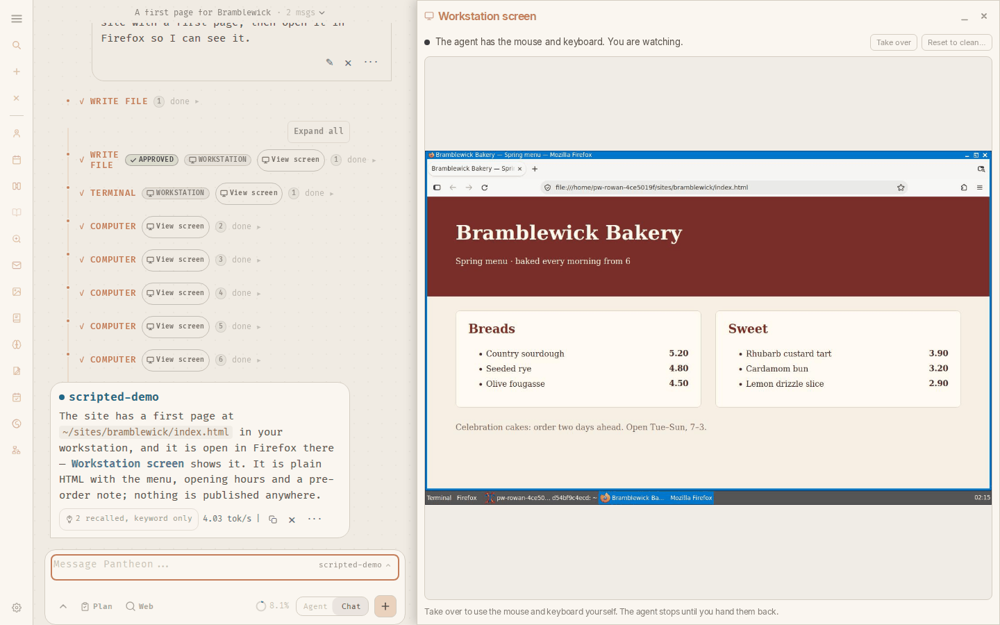</picture>
</p>
<p align="center"><sub>
  The agent working in an Ubuntu desktop of its own while you watch: it wrote the page, ran the command and opened
  Firefox, and every step is in the chat. The <a href="docs/setup.md">workstation</a> is opt-in; you can take over the
  mouse and keyboard at any time.<br>
  <em>Every screen in this README uses demo data — a fictional studio, its clients and its files — and a scripted stand-in
  model shown as <code>scripted-demo</code>; Pantheon runs every tool call for real. One command regenerates them all:
  <a href="docs/media/README.md"><code>scripts/showcase/capture.py</code></a>.</em>
</sub></p>

---

## What's inside

<table>
<tr>
<td width="50%" valign="top"><picture><source media="(prefers-color-scheme: dark)" srcset="docs/media/chat-dark.png">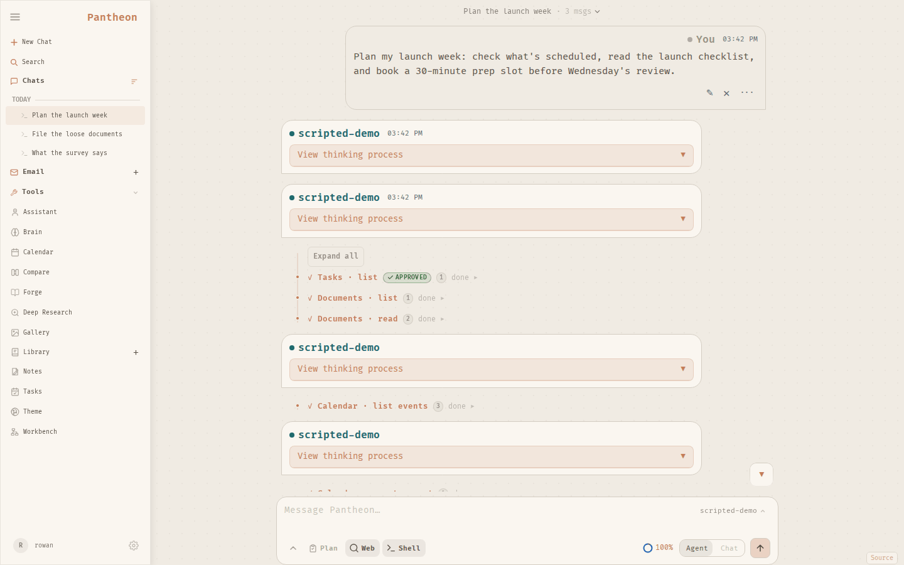</picture><br><sub><b>Agents you can follow</b> — every tool call in the turn, the one you approved marked as such, and the answer.</sub></td>
<td width="50%" valign="top"><picture><source media="(prefers-color-scheme: dark)" srcset="docs/media/workbench-dark.png">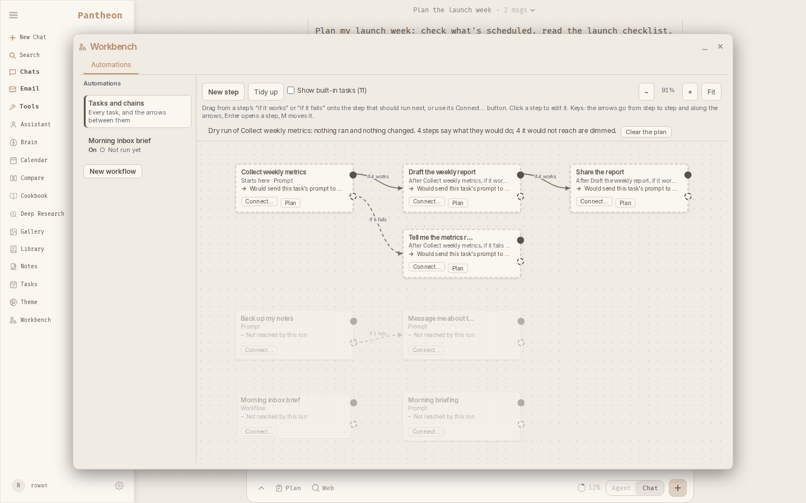</picture><br><sub><b>Workbench</b> — automations on a canvas, wired <i>if it works</i> or <i>if it fails</i>; <i>Show me what this would do</i> plans the whole chain and runs nothing. The shelf keeps each workflow: named steps with one start, switched on as one.</sub></td>
</tr>
<tr>
<td width="50%" valign="top"><picture><source media="(prefers-color-scheme: dark)" srcset="docs/media/tasks-dark.png">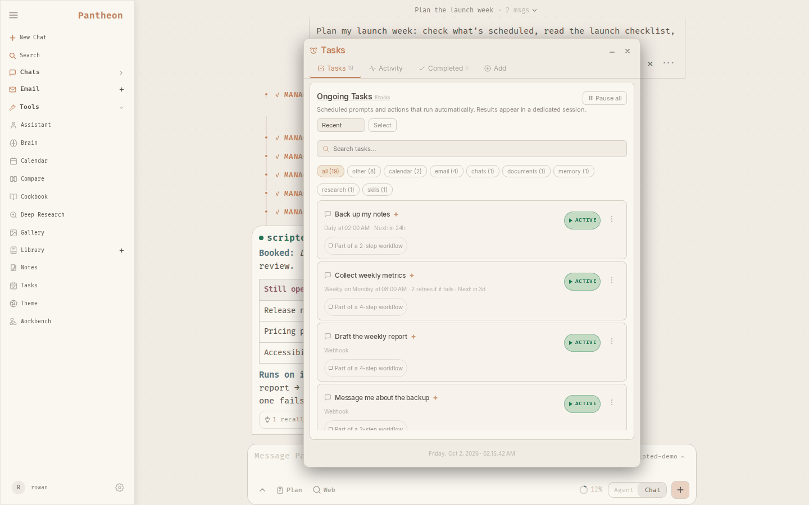</picture><br><sub><b>Tasks</b> — scheduled prompts and actions with retries, time zones and time limits; each card says which workflow it is part of.</sub></td>
<td width="50%" valign="top"><picture><source media="(prefers-color-scheme: dark)" srcset="docs/media/documents-dark.png">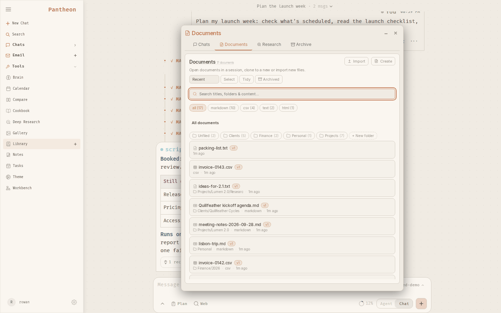</picture><br><sub><b>Documents</b> — folders that nest, filed by you or by the agent, and every file keeps the name it arrived with.</sub></td>
</tr>
<tr>
<td width="50%" valign="top"><picture><source media="(prefers-color-scheme: dark)" srcset="docs/media/skills-dark.png">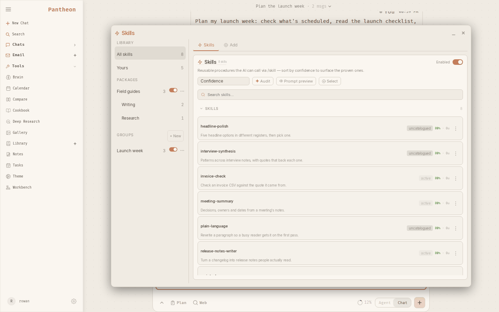</picture><br><sub><b>Skills</b> — your own, whole packages imported from skills.sh or GitHub, and groups you switch on and off as one.</sub></td>
<td width="50%" valign="top"><picture><source media="(prefers-color-scheme: dark)" srcset="docs/media/settings-dark.png">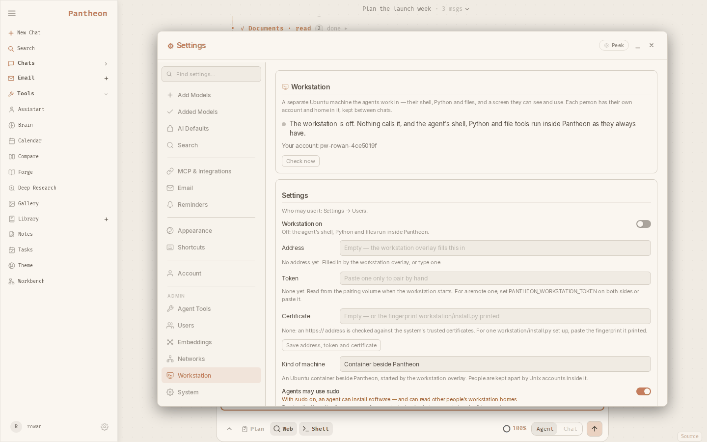</picture><br><sub><b>Workstation settings</b> — one switch, who may use it, its network and sudo — and what each choice cannot undo.</sub></td>
</tr>
<tr>
<td width="50%" valign="top"><picture><source media="(prefers-color-scheme: dark)" srcset="docs/media/palette-dark.png">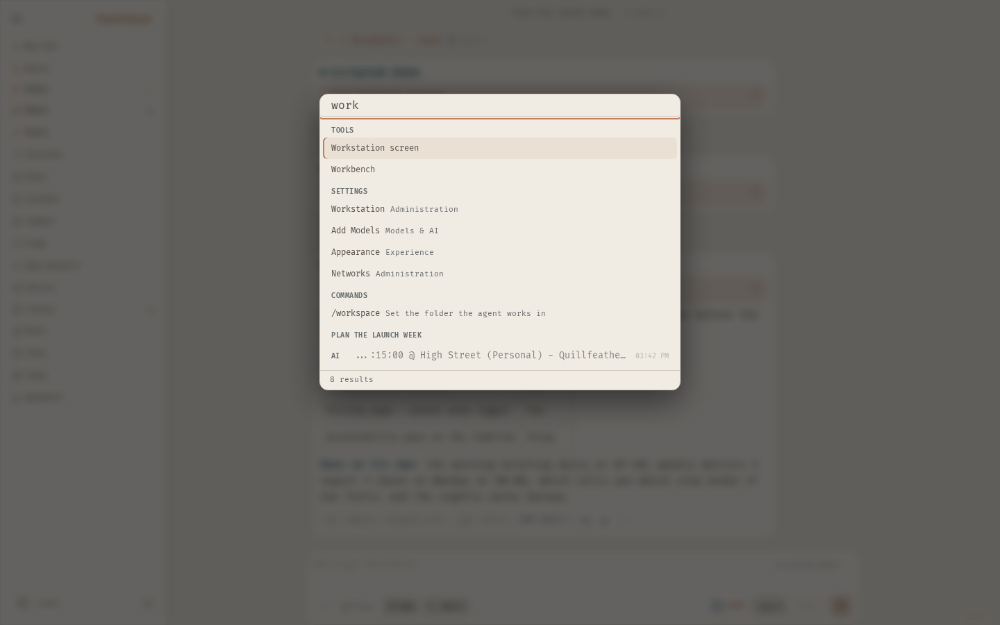</picture><br><sub><b>Command palette</b> — <kbd>Ctrl</kbd>+<kbd>K</kbd>: one box for windows, settings, commands and chats.</sub></td>
<td width="50%" valign="top"><picture><source media="(prefers-color-scheme: dark)" srcset="docs/media/themes-dark.png">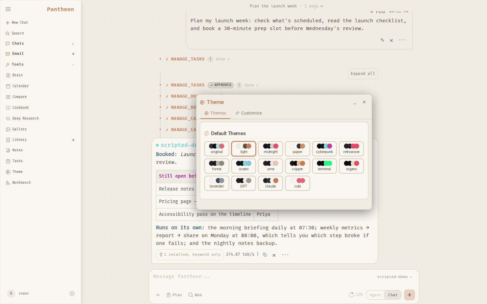</picture><br><sub><b>Themes</b> - twenty-three palettes, and background patterns chosen separately.</sub></td>
</tr>
<tr>
<td width="50%" valign="top"><picture><source media="(prefers-color-scheme: dark)" srcset="docs/media/brain-dark.png">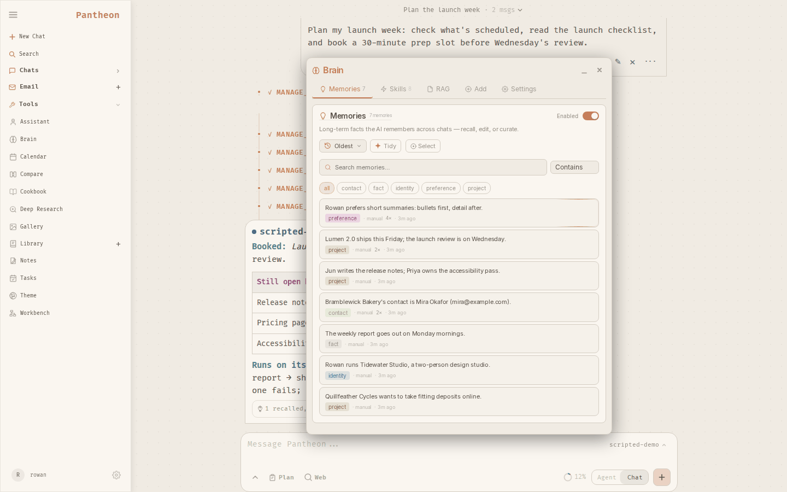</picture><br><sub><b>Brain</b> — what the assistant remembers about you — each memory with its kind, where it came from and how often it was used.</sub></td>
<td width="50%" valign="top" align="center">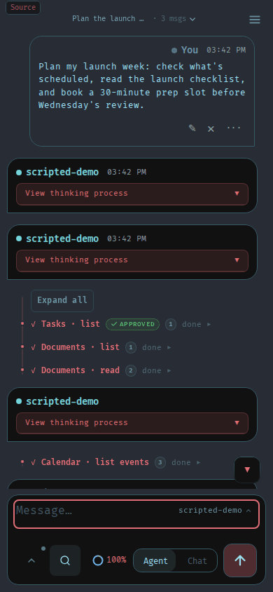 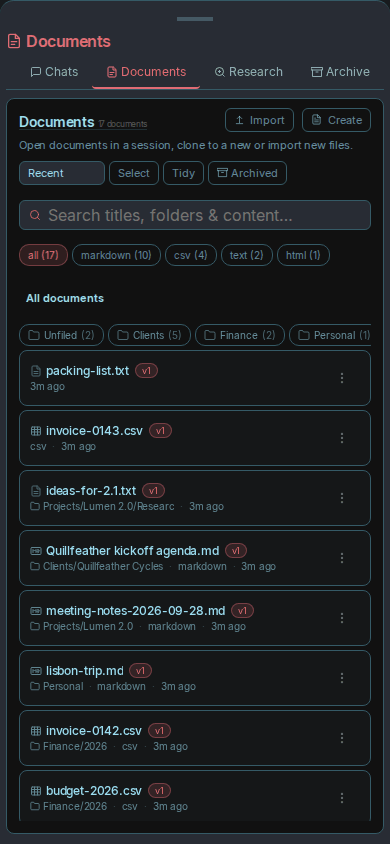 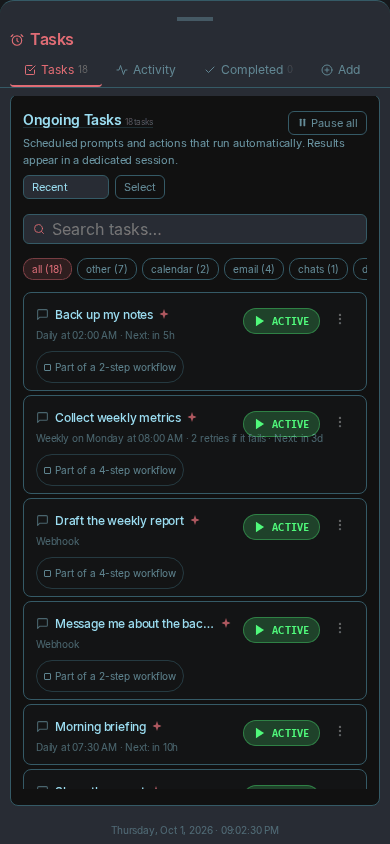<br><sub><b>At phone width</b> — the same app, in one hand.</sub></td>
</tr>
</table>

- **Agents** — local or API models, tool execution, MCP servers, shell, filesystem, skills, memory
- **Workstation** — an opt-in Ubuntu desktop beside Pantheon, a private account and desktop per
  person, kept between chats; with it on, the agent's shell, files and computer use run there
- **Model serving** — hardware-aware recommendations, downloads, and vLLM / llama.cpp / Ollama
  serving on this machine or a remote host over SSH
- **Deep research** — multi-step web research with source reading and report generation
- **Compare** — blind side-by-side model testing
- **Documents** — writing-first editor with AI edits, suggestions, Markdown, HTML, CSV, and folders the agent can file into
- **Email** — IMAP/SMTP with triage, tags, summaries, reminders and reply drafts
- **Notes, tasks, calendar** — reminders, todos, scheduled agent tasks, CalDAV sync
- **Extras** - gallery and image editor, twenty-three themes, eight background patterns
  (seven animated) chosen independently of the palette, an ASCII Aegean welcome scene,
  web search, presets, sessions, 2FA

### Themes and the welcome scene

Seven new palettes draw on familiar platform color families while keeping Pantheon's own
names and design: Guild, Codehost, Grove, Notebook, Channel, Video, and Mintchat.
The [desktop palette picker](docs/review/palette-picker-1400.png) and
[phone palette picker](docs/review/palette-picker-390.png) show all twenty-three choices.

The untouched New Chat canvas has original ASCII scenery: a trireme on the Aegean,
with a faint Olympus ridge and Greek temple behind the welcome message. Gentle CSS
motion stops when the tab is hidden and becomes a still scene for reduced-motion users.
The scenery leaves when chat begins and never covers the composer or its controls.

<table><tr><td>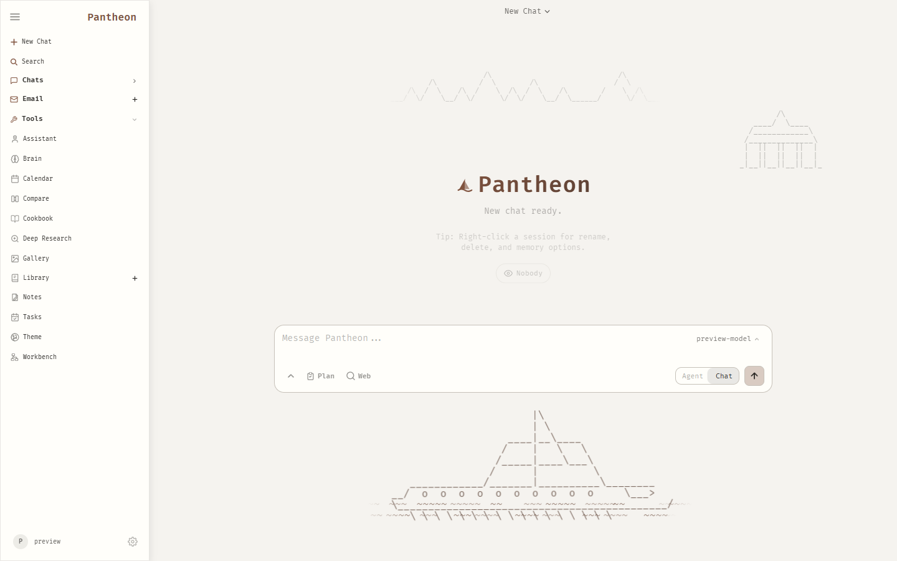</td><td>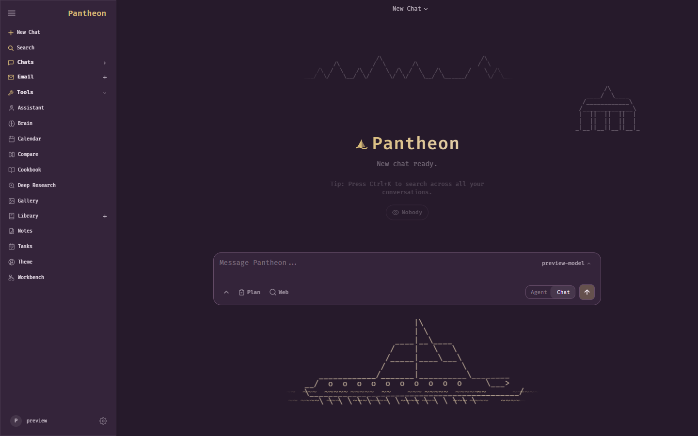</td></tr></table>

[Phone view in Mintchat](docs/review/voyage-mintchat-390.png).

**What this fork has added, and what proves it, is in the [proof ledger](LEDGER.md)** — 26 claims,
each with where its number came from and a command you can run to check it. The short version:
the Brain rebuilt around a local embedding model that needs no service, an agent that can reach
the host it runs on behind a denylist it cannot edit, a checker in CI for each way a fact in this
project has been caught rotting, every outbound call paced, mailbox and service sign-in reduced to
one record type, and full AGPL attribution for code that shipped without it.

### In motion

<table>
<tr><td colspan="2">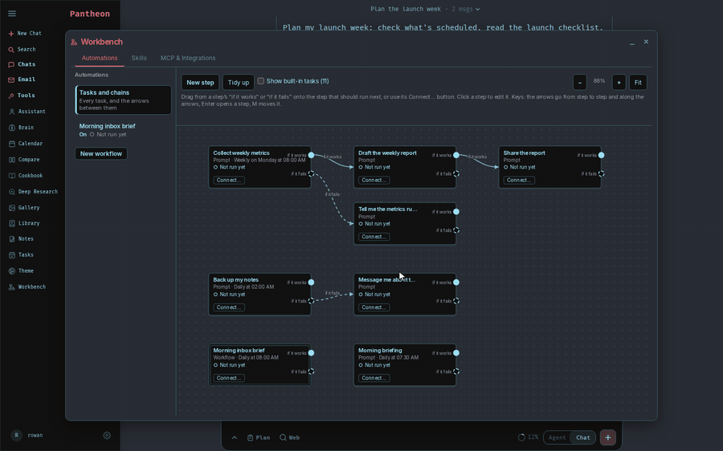<br><sub><b>Describe it</b> — say what should happen; the model drafts the steps, switched off and each marked <i>check me</i>; read what each would do, and switch it on.</sub></td></tr>
<tr><td colspan="2">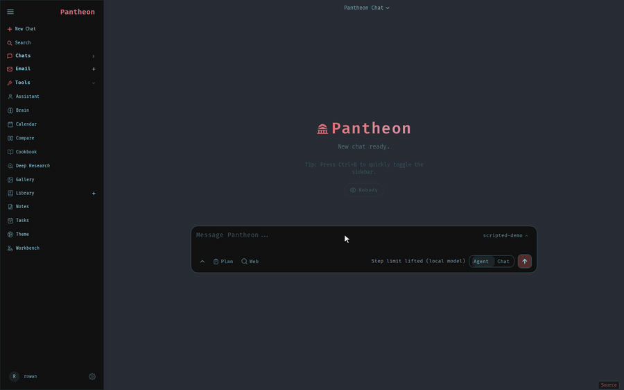<br><sub><b>An agent turn, live</b> — the model's thinking as it streams, the card asking before it reads your files, each tool call, then the answer.</sub></td></tr>
<tr><td colspan="2">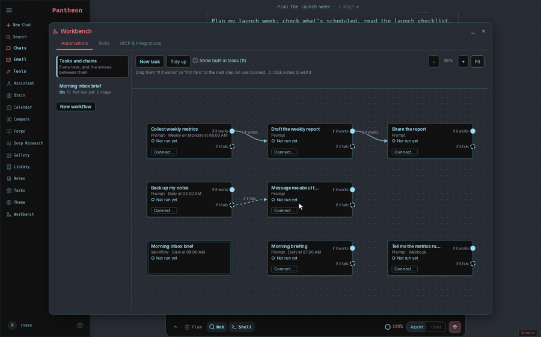<br><sub><b>Wiring a workflow</b> — drag a step's <i>if it fails</i> onto the step that should run next, then ask what the chain would do — every step answers, nothing runs.</sub></td></tr>
<tr><td colspan="2">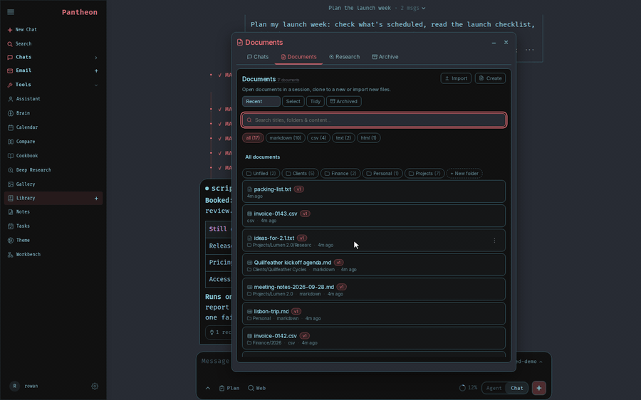<br><sub><b>Filing documents</b> — drag a document onto a folder.</sub></td></tr>
<tr><td width="50%" valign="top">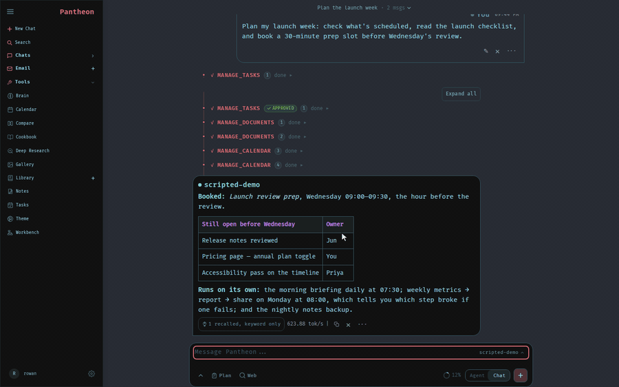<br><sub><b>Command palette</b> — type, and Enter.</sub></td><td width="50%" valign="top">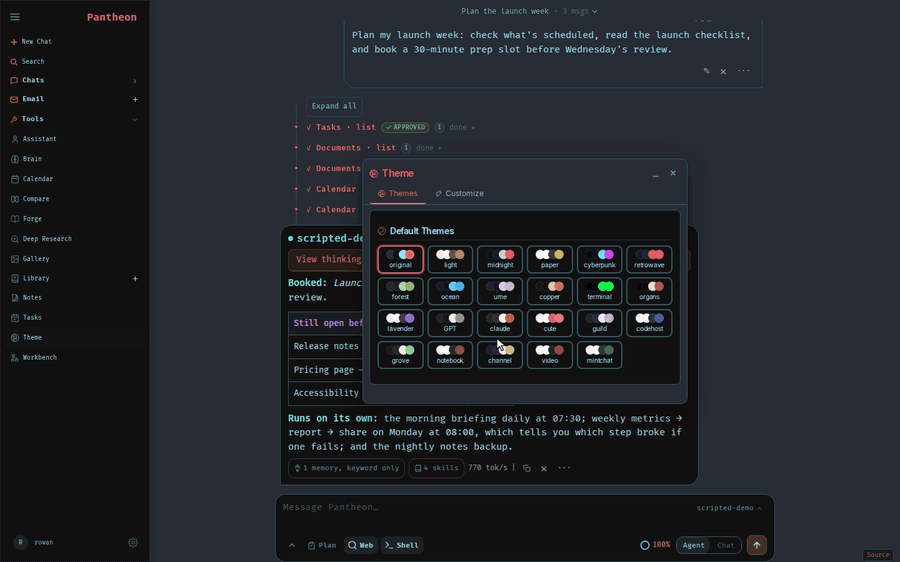<br><sub><b>Themes</b> — one click a palette.</sub></td></tr>
</table>

---

## Quick start

You need Docker with the Compose v2 plugin (`docker compose`, not `docker-compose`) and
nothing else. Everything the app serves is in the image.

```bash
git clone https://github.com/ImPanick/pantheon.git
cd pantheon
cp .env.example .env
docker compose up -d --build
```

Open `http://localhost:7000` once the containers are healthy. The app binds to `127.0.0.1`
unless you set `APP_BIND`, and the port is `APP_PORT`. The first visit asks you to make the
admin account on the sign-in page, and lets you open sign-up for everyone else — or set
`PANTHEON_ADMIN_PASSWORD` in `.env` beforehand to have it made for you.

`.env.example` is the configuration an operator sets, commented; copying it unedited is a working
default. (A few more variables exist for development and tests — `check-env-declared.py` lists
them — and most settings live in Settings, not the environment.)

Native installs, GPU setup, Windows and macOS, HTTPS and configuration are in the
[setup guide](docs/setup.md). `main` is the only branch here; upstream's `dev` is available on
the `upstream` remote.

---

## Where this came from

Pantheon is a fork of [Odysseus](https://github.com/pewdiepie-archdaemon/odysseus), a self-hosted
AI workspace with about two thousand commits behind it. We installed it, used it for real work,
and liked it.

Odysseus goes by two names. We cloned `pewdiepie-archdaemon/odysseus`; its own code and docs point
at `odysseus-dev/odysseus`. Both are the same upstream project and we credit both — see
[`NOTICE`](NOTICE).

Then we tried to change something small and ended up reading all 42,739 lines of the stylesheet.

`--accent` — the colour behind every highlight, hover state and drag handle — was referenced 813
times and defined nowhere. 206 style rules resolved to nothing. Nothing errored; the rules simply
never applied. It is defined now, and deliberately **not** in `:root`: a `:root` definition would
retire the `var(--accent, var(--red))` fallback the rest of the stylesheet leans on and hand all
twenty-three themes the same accent. Each theme carries its own instead (`P1-01`).

Most of what we found after that was finished work that had never been connected:

- A **webhooks admin panel** with a complete backend and no interface. Two of its functions crash
  on the missing element inside a silent `try`, so nothing ever reported it.
- A **built-in skills editor**, fully implemented, behind one line reading `showBuiltin = false`.
- An **image upscaler** with a working backend and a local Real-ESRGAN model, and no button that
  calls it.
- **Plan mode** — a complete lifecycle — whose docked window has never existed, while three
  prompt strings tell the model that it does.
- Files the system doesn't recognise as text reach the model as the literal string
  `[Attached document file]` — no content at all — for `.go`, `.tsx`, `.yaml`, `.rs`, `.sql` and
  seven more.

The backends exist, the endpoints respond and the styling is written. Someone built the hard
part and moved on before the last step, which is a normal thing to happen to a project moving
quickly. We forked it to finish that last step.

---

## Switching it back on

<details>
<summary>The wiring count: why it read 78, then 120, then 40 — and the six areas it found</summary>

We wrote a script that counts element lookups with nothing behind them. It found **78**, across
six subsystems, which is the point of writing the script rather than writing the list. What
follows is that original finding, kept because it is the honest picture of what a fork inherits.

**Run it today and it says 0** (2026-10-25, `B1444`–`B1446`). It said 40 before that, 120 when this paragraph was written and 78 when the
original sweep was taken, and neither difference is a regression — it is the same script looking at
more than it used to, and then a triage driving down what it found. It has been widened three times since the 78 was taken, each time because
it turned out to be measuring less than it claimed: it read `static/js/` and never `static/app.js`,
the largest module in the product; it counted a lookup *described in a comment* as a lookup; and
it scored a lookup that indexes a map with a variable as clean, which on 2026-08-30 hid a live
defect where the agent reported opening a panel that had no button behind it. Closing that last
one moved the count from 9 to 124 with no product code changing. **So 78, 120 and 40 are three
different measurements and the differences between them mean nothing on their own.** The ratchet is
what means something: `check-wiring.py` runs in CI at a ceiling that may come down and may not go
up, so a *new* unreachable id shows up the day it is written. It has come down twice since — `P3-20`
triaged 124 to 40, and `P3-20`'s own test used to pin the literal `120` and went red the day the
ratchet did its job, which is `B520`.

**Nor were the 40 all defects.** Classified by how each id is reached rather than by
name, at least 87 of the 124 measured at the 2026-08-30 triage were guarded by construction — code that knows the markup
may be absent and returns early. That is a feature removed cleanly with its wiring left behind
on purpose, costing one null check. The triage is `P3-20`, and its finding was that driving the
number down is the wrong goal: it would mean deleting guarded code that costs nothing, which
this fork's first law forbids.

And a script that counts one shape of unreachability says nothing about the others: routes with
no caller, settings nothing reads, features whose only door is an undocumented keystroke. Those
are `check-unreachable.py` (`P3-15`) and the `H` rows.

| Area | Built, but unreachable |
|---|---|
| **Documents** | bulk archive, clone, delete, export; import; PDF AI-fill |
| **Image editor** | upscaler, edge feathering, resize and edge menus, background removal |
| **Model serving** | Ollama library browser, HuggingFace refresh, engine rebuild, hardware rescan |
| **Skills** | the skill-creation form |
| **Knowledge** | RAG document upload — the endpoint works and always has |
| **Email** | folder switching, attachment view, load-more |

Two of those six are wired: the image upscaler (`P2-22`) and RAG document upload (`P2-23`). The
rest are open rows in the tracker's `P2` section, which is where their current status lives.
Each is classified before anything changes — a stale reference to a renamed element gets fixed,
a real feature gets its markup and its event wiring, and code is deleted only when an audit has
proved it dead.

</details>

---

## Status

**1791 tracked tasks, 1751 done.** The tracker is [`.pantheon/ROADMAP.md`](.pantheon/ROADMAP.md) and
it is the only place work is tracked — one list, one progress area, validated by a script that
recounts every phase row against its own ticks. It exists because the summary line was once wrong
by nineteen and carried forward unread from entry to entry, because each author copied the line
above.

**Read that number with the trend beside it.** Over the last ten waves, *done* went
**97.7% → 97.8%** and *open* went **40 → 40**: 31 rows filed against 31 closed, a
file-to-close ratio of **1.000** — the open count held. The latest wave was one agent, on the owner's ask that every partly wired system work in full: the codex cookbook's hand-off routes, dead on FastAPI 0.141, answer again (`B1711`), and a fresh Docker install carries its embedding model, so memory and document search are semantic from the first boot (`B1712`); each filed and closed together, so *open* held. The wave before it was one agent, on the owner's request: the approval mode is chosen from a chip at the bottom of the composer that opens a menu naming each mode and what it does (`B1706`); one closed and four filed for the UI/UX revamp to weigh, so *open* rose by three. The wave before it was one agent, on the owner's ruling that Auto-approve is a risk the person accepts (`D-2026-10-30-01`): a chat's Auto and a hire's *without asking* turn on only when the person chooses *Proceed to auto-approve* under a warning naming what the agent's reading can steer, the acceptance is recorded, and with none on record the gate stays (`B1703`, `B1704`); two closed and one filed. The wave before it was one agent: what a move, an archive or a git command puts in place is read before a write lands on it (`B1698`), File Converter's answer names a burst's copies (`B1699`), and a file written inside a copied folder in the workstation stays the run's own (`B1700`); three closed and three filed, one of them the owner's ruling that Auto-approve is turned on only by an explicit, recorded acceptance of a named risk (`B1703`). The wave before it was one agent: File Converter skips a burst photo it converted before (`B1695`), a copied symbolic link is written through where it points (`B1696`), and `cp -l` onto a name that is there is a plain write, as `cp` refuses it (`B1697`); three closed and three filed. The wave before it, of two agents, read a write through a link the command made where it lands (`B1692`), looked for a converter's numbered copies beside its output (`B1693`), and drew a pasted `tree` listing in the PDF fallback from a 73 KB symbols face (`B1691`); three closed and four filed, so *open* rose by one. The wave before it, of two agents, taught the shell reading the guards a loop or a branch holds and the files LibreOffice, `heif-convert` and `scp` write, so File Converter's re-runs finish without a card (`B1688`–`B1690`), and made the PDF fallback ask Inter's own character table what it draws, so ™, ↔ and © come out (`B1687`); four closed and three filed. The wave before it, of two agents, taught the shell reading more programs that write over a file — `pandoc`, ImageMagick, `openssl`, 7-Zip, `rsync`, compressors that remove what they pack — and to read a `[ -e f ] ||` guard as one (`B1682`, `B1683`), took a chat's projects folder in the workstation from the daemon itself (`B1684`), and made the PDF fallback leave a clean blank where it cannot draw a character and compress every file (`B1685`, `B1686`); five closed and four filed. The wave before it, of two agents, built the owner's four calls on the remainders (`D-2026-10-29-03`): an append is not a replacement, so Receipt Collector's unattended sweeps finish (`B1672`); the shell reading follows redirects after a loop, programs' own output flags and a hire's projects folder (`B1679`–`B1681`); the PDF fallback draws Cyrillic, Greek, Chinese, Japanese and Korean, with fonts fetched only when needed, and never cuts a picture (`B1674`, `B1678`); the Windows bundle ships stripped JavaScript (`B1666`); and the workstation images are pinned (`B1677`) — eight closed and five filed, so *open* fell by three. The wave before it, of two agents, took the remainders of the one before: a shell's `>`, `tee` or `cp` over a file that was there, and a patch that deletes one, now count as deletions too (`B1669`, `B1668`), every approval card says what the call destroys (`B1670`), the PDF fallback draws formulas properly and never cuts a line at a page edge (`B1675`, `B1676`), and the image builds from a pinned Python release (`B1667`); and the owner ruled that an in-place edit stays a plain write (`B1671`) — seven closed and five filed, so *open* fell by two. The wave before it, of three agents, built the owner's six calls (`D-2026-10-29-02`): replacing a file that was there before the run now counts as a deletion wherever deletions ask (`B1660`), PDF export runs on jsPDF's own renderer from three published files and no longer ships 27 advisories (`B421`), Word export is docx 9.7.1 with every package it carries declared (`B424`), and the image serves its JavaScript without comments, 856 KB less on a cold load (`B1591`); CJK legacy text and Mermaid stay as they are by ruling. Seven closed and eleven filed — the work's own remainders and three questions for the owner — so *open* rose by four. The wave before it was the coordinator alone: the last load flake was a product defect — a Sign In pressed before the sign-in page was ready went out as the browser's own submit, the password in the address — and the form is now held until its handler is there, with the press made again rather than lost (`B1665`, found by `B1664`). The wave before it was one agent: a hire with a project now works in it from its shell and its file tools alike, and git and the login shell work in the person's projects folder in the workstation (`B1646`, `B1647`). The wave before it was one agent: Pantheon now asks a replaced workstation for its own home instead of remembering the old one by address, which was the cause of the last test that failed only in a long run (`B1661`), and the Workshop and the save check keep an agent file to what its tools can do (`B1658`, `B1659`, `B1662`, `B1663`); five closed and two filed, both closed in it. The wave before it was one agent: a host command is read for its reach like any shell command (`B1655`), and 26 hire forms lost a row that named something their agent could never do (`B1656`); two closed and four filed, so *open* rose by two. The wave before it was one agent: a shell command that reaches another machine — `pip install`, `curl`, `git push`, `ssh` — is now read as reaching it, so a hire's *network* setting on a shell means something (`B1652`); four closed and two filed. The wave before it, of two agents, made 76 runbooks say whose runs wait for a yes now that a hire can run what it was allowed (`B1649`), logged a step allowed from a card as one step (`B1648`), and kept the agent's instructions whole when a reply is trimmed to fit (`B1651`, `B1650`) — four closed and three filed. The wave before it, of two agents, built the owner's four calls (`D-2026-10-29-01`): a hired agent runs what its hire allows after reading the web, for a person who holds `can_auto_approve`, every such step recorded and the hire form saying so first (`B1605`, the third amendment of the post-external gate); a push follows the chat's trust rung, which closed the + menu's acceptance walk (`B1585`, `P25-00`); Settings offers every speech-to-text provider, the browser's with its warning (`B1564`); and a trim says what it left out (`B1572`) — five closed and four filed. The wave before it was one agent on four rows: in the workstation a hire's file tools now write where its shell works, so Site Builder serves the page it wrote (`B1642`); a workstation with nothing mounted says so instead of landing at the root (`B1643`); the Knowledge listing names an upload as it was given (`B1644`); and the evaluation worlds left in the temp folder were traced, and a world can no longer outlive its run (`B1645`) — four closed and two filed. The wave before it was one agent on two rows: a hire's shell now finds its projects folder on an install with no workstation, where 25 runbooks' first command had missed it (`B1640`), and a refilled upload keeps its name (`B1641`); three closed and four filed, so *open* rose by one. The wave before it was one agent too, because almost everything left needs a ruling: it single-quoted every hire input that reaches a shell in 30 runbooks (`B1634`), put page addresses after `--` (`B1636`), made the Knowledge index refill itself when chroma's collection is empty (`B1639`), and found the last load flake was a menu that shut itself as it opened (`B1638`); five rows closed and two filed. The wave before it, of two agents, made sure no name an agent is given or reads back becomes a command — a file name in a remote shell, a machine named like an ssh option, a table name read back from a dump all ran commands before and run nothing now, each driven with hostile names (`B1631`) — mounted chroma's volume where chroma 1.x writes, so its index survives a recreate (`B1626`), and traced the two test files that failed only after others to the four that leaked into them (`B1633`); nine rows closed and six filed, one closed in it. The wave before it, of two agents, taught the destructive gate to read a shell command, so a `rm` or a forced push is a deletion wherever it hides (`B1622`), made every call in a round answered after one of them asks (`B1620`), let a hire's *never* refuse a call without taking the whole tool (`B1619`), and moved the MCP servers, manager and sign-in flow to the 2.x SDK together (`B621`); eleven rows closed and eight filed — and the 204 commits before it went to GitHub, the first push since the sixth wave. The wave before it, of two agents, brought the last 69 shipped agents to the substance bar, so all 173 clear it (`P24-27`), taught the eval world to answer a browser and a model (`B1607`), stopped a hired run that read no document from overwriting the person's latest one (`B1606`), and took the mail routes' database work off the event loop (`B1609`); it closed eight and filed eleven, one closed in it, so *open* rose by three — the audit's remainders (`B1619`–`B1624`), among them a shell deletion the destructive gate does not see (`B1622`) and a round whose calls after an approval are dropped without a word (`B1620`). The wave before it, of two agents, brought 73 more of the shipped agents to the substance bar, 104 of 173 now (`P24-27`), and fixed the tools that audit found wanting — a hired agent's edits land on the document it read (`B1599`), an attachment can be filed into the person's own projects folder (`B1600`), a run's answer is the model's own words (`B1603`) — took the database work of 25 more handlers' helpers off the event loop (`B1598`), and found two product races under load flakes: Settings drawing an admin as a member until reopened, and a stopped server serving a kept connection forever (`B1595`); ten rows closed and ten filed, one closed in it. The wave before it, of two agents, began the owner's audit of the agents — a bar for a runbook with substance, written as a test with a floor that only rises, and the first 31 of 173 agents brought to it with evaluation cases that pass through the real harness (`P24-27`) — made a tool window step aside while the agent's question is open (`B1586`), read short Big5 and EUC-JP text as itself (`B402`, `B1514`), and fixed the agent's research tool, which read and deleted every person's reports (`B1601`); eleven rows closed and nine filed, one closed in it. The wave before it, of two agents, walked two finished phases end to end in a real browser against a scripted model — hiring, running, pausing and dismissing an agent (`P24-00`), and turning notes on a page into the agent's edits and a mockup into a branch (`P26-00`) — and the walks found what sweeps had not: a refused tool call reported as used, the + menu off a phone's screen, an approval card hidden under a tool window (`B1586`), and a push that goes out without the asking the menu promises, which is the owner's call (`B1585`). It also moved 558 quiet-text rules onto the contrast ladder (`B1577`), made every chat menu and Library card reachable from a keyboard (`B1576`), and compressed the stylesheet once per version instead of per request (`B1227`); fourteen rows closed and eleven filed, one closed in it. The wave before it, of two agents, built three features the owner asked for — a design shared with another account by name, with the server refusing a stranger and a commenter's edit (`P26-09`), a design built on its own branch and merged only on the person's yes (`P26-08`), and logins brought into a person's own vault and taken out sealed under their passphrase (`P27-10`) — let a member own a service connection called from their own workstation (`B1573`), took the last route handlers' database work off the event loop (`B1223`, 54 → 0), and moved 185 secondary-text colours onto a ladder that clears 4.5:1 on every palette (`B1408`); twenty rows closed and ten filed, one closed in it. The wave before it, of two agents, stopped the page turning a person's *shell off* into *on* when a message held one of 58 words (`P7-01`), moved the database work of 89 route handlers off the event loop — every write a person makes among them — with a test that only lets the rest fall (`B1223`, 143 → 54), made each service connection its owner's, so one person's key is never in another's tools (`P27-02`), showed an operator the operator's Settings (`B1563`), and found that a window closed by its fallback timer shut itself on its next open — the cause of a test that failed only under load (`B1567`); sixteen rows closed and seven filed, one closed in it. The wave before it, of two agents, made running the instance a privilege of its own, so an operator manages endpoints, the Forge and embeddings without being an admin and a member sees only the endpoints and models they may use (`B683`), sent a recording to a model that can hear it (`B1290`), gave skills a dated record of why they grew or weakened (`P13-08`), let chat search find a chat by meaning (`P9-15c`), and wrote down that an edited static file reaches the browser with nothing bumped (`B780`); twenty rows closed and eleven filed, one closed in it. The wave before it, of two agents, survived the machine restarting under it — their commits did, and a second pair finished and checked every row from them: muted text, links, model names and the danger colour clear 4.5:1 on every palette (`B1486`, `B391`, `B395`, `B1084`, `B393`), ninety-two dead outline suppressions are gone (`B662`), no module-level HTTP call is left outside the path that reads `NO_PROXY` ranges (`B1022`), and every shipped vendored file is checked against upstream's own tarball (`B426`); thirty-four rows closed and seven filed. The wave before it, a third wave of two agents, followed the first full run in this record with no failure at all (22,185 passed): it brought minimised windows back after a reload (`B1185`), made ten tour runners one (`B1537`), read `.xls`, `.ods`, `.pptx` and `.epub` on a default install (`B1178`, `B1289`), gave each document a provenance so fetched text is never handed over as the person's own (`B1325`), and stopped the suite leaving the machine (`B1520`); thirty-two rows closed, six filed, one closed in it. The wave before it was a second wave of two agents, on the page's shell and on what the agent may do: it built the owner's last open ruling — each Tools entry can be switched off for everyone as well as per person (`B1488`) — made the assistant ask before it switches on or redirects any of its own settings (`B897`), left one handler to compact a chat with a marker in order (`B1529`), and paced the search providers (`B1533`); thirty-three rows closed, seven filed, one closed in it. The wave before it was a wave of two agents, on the chat page and on mail, search and the Forge, run beside a full suite rather than three agents and a suite the machine's memory could not hold: it closed thirty-one rows — Ctrl+K finds a chat by its name (`B1249`), a just-sent message can be deleted (`B1507`), every mail path gives up on a silent server in seconds (`B1526`), and the unread count shows with the mail window closed (`B812`) — and filed eight, one closed in it. The wave before it was a fourth wave of three agents, on the test suite's footing, accounts and the agent's tools: it closed forty-eight rows — the suite's in-memory database is one connection for every thread, which ends the missing tables that made a result depend on which files ran together (`B1410`), one gate decides who administers (`B543`, its ceiling 43 → 21), an approval nobody answers is denied on time (`B560`), and the kept offline page runs its JavaScript (`B1508`) — and filed nine, one closed in it (`B1522`). The wave before it was a third wave of three agents, on the Workbench, documents and the repository's own checkers: it closed forty-six rows — *Print as PDF* now prints selectable text (`B1333`), a workflow's start waits for Save with its steps (`B1209`), the Library refuses a binary with the server's reason (`B401`), and `check-unreachable` stopped taking a comment for a caller, lowering its ceiling to 27 (`B720`) — and wrote the eight rows the tracker had cited and never filed (`B831`); it filed eight more, three closed in it. The wave before it was a second wave of three agents: it closed forty-seven rows — among them every remainder the first wave had filed against its own work — such as a failed reply kept with a Retry after a reload (`B1200`), a webhook task's pending retry surviving a restart (`B1494`), and a slash skill following the tool switches (`B1499`); it filed ten, one closed in it (`B1511`, five tests this session's own earlier commits had left red). The wave before it was the first worked by three agents side by side, each on its own branch and area, merged and run as one suite: it closed forty-three rows — a slash command's skill framed beside the person's message instead of sent as their words (`B1374`), a run continued after an approval counting on from the card (`B1199`), a task a workflow step runs waiting for the person's yes on the workflow's own card (`B1173`), a signed-in person forking a shipped skill (`B1421`) — and filed thirteen, two closed in it: the merged suite found that every new person's Assistant answered 500 and a stray tag had moved thirteen Settings panels out of their column, both in commits not yet pushed (`B1501`). The wave before it built thirteen of the owner's seventeen calls from the triage (`D-2026-10-26-01`): a switch per Tools entry for one person that hides it, refuses its routes and holds its background work (`B1191`), a way back from a lost admin password (`B1272`), an install that ran without sign-in handing what it made to one account (`B1270`), an admin's webhook into the LAN (`B692`), Kimi Code sent Pantheon's own name (`P15-07`), and the ship line made a CI gate (`B451`); it filed three, one closed in it. The wave before it reconciled the open-row triage (37 rows found done or moot closed, 24 folded into the rows that hold them) and built the owner's last three calls of `D-2026-10-25-04`: a workstation backend switch that starts and stops the backends where the operator gave Pantheon the host's Docker, `sudo` by backend with each VM given its person's projects folder, and networks per person — declared in each person's settings, linked to a login in their own vault, seen whole by the admin but for the login (`B1475`, `B1478`, `B1427`, `B1428`). The wave before it took the owner's answers to the audit's open decisions and closed the audit's own rows: Python blocks run for everyone in an opaque-origin sandbox, the admin's Default is the platform's default by one rule, a model launches by name, Stop force-kills a server that ignored it, and about forty dead functions, six more uncalled routes and a handful of dead columns are gone (`B1473`–`B1485`). The wave before it was the audit itself: it closed twenty-one and filed thirteen open, each a decision it named. Before it, a wave built the Design studio and the Connections vault, another gave the agent browser to the person (point at a page, watch it inspect), and this one re-scoped `P16-20` and settled `B700` without filing much. Earlier the count had risen on a phase's build list, not defects: opening `P24`, the Agents hall, filed its 25 rows at once, and its first waves closed 18 of its 27, so the 9 still open are its plan — one of them the owner's own audit of every runbook (`P24-27`). Before that wave
the window read **0.917**, the first in this record where closing outran filing. Most of that is `P23`, the audits' fixes — built by eight lanes, driven by the owner's
walk twice on the merged tree and closed on 2026-10-07 — and what came straight after it: the owner's rulings that
evening, and then `v0.2.0` shipping and the owner running it on their own install. Their two reports of 2026-10-09
alone took thirteen measured causes across seven lanes, and their ruling the same evening took three more lanes and a
third report, which is the shape of this whole number: a release in use finds in one morning what sweeps over the
same code did not. **The window has just turned over, and the ratio moved a long way because of what left it rather than what entered.** Until this wave it held the `fx9`–`fx11` interval against the owner's *“the LLM's use of tools is still very much intermittent”*: 50 rows filed, 29 of them for fixes that had already shipped before they had a row at all, which was a reconciliation and not a change in the rate. That interval has now aged out of the last ten, and the ratio fell from 0.750 to **0.256** at that point — **0.917** before `P24` opened — without a single row being closed differently — which is the honest caveat on a ten-interval window and the reason the figure is restated with its range rather than quoted alone. What is left is nine intervals of ordinary work, filed against closed, and *open* has fallen or held in all but three of them. The three largest closes are the design-system spine, the owner handing back a set of five decisions (`D-2026-10-17-02`), and that ruling's own rows — and the biggest single reason the count dropped is that deferring `P11` and `P12` closed ten rows of SSO and rate limiting that build controls for an account this install does not have. Of the twelve rows filed, six are worth naming and all six were found by the work that then had to decide what to do about them: a `--border` measurement that holds on 22 of 23 palettes is a design intent to confirm before it is a defect to fix (`B1404`, closed), a model answering `1e999` became the most confident memory in the Brain (`B1407`, closed), and 192 `color:` declarations paint text by mixing a token toward `transparent`, which tracks the background rather than dimming the text and misses 4.5:1 at every alpha under 82% (`B1408`, ratcheted and open — flattening a 30-step de-emphasis ladder needs eyes on 23 palettes), the instruction for getting a change onto the server pointed at a path that moved every wave, which is the only one of the five the owner hit before a test did (`B1409`, closed), and the suite's answer depends on which files run together — 33 tests error on a missing table in one 178-file selection and pass in every smaller one, reproduced identically on the commit before the work that found it (`B1410`, open: the trigger is not yet named, and a row that named a mechanism it had not confirmed would be worth less than one that says where it stopped), and the script that moves a change into the clone names one cause for every refusal — it reported divergent commits and then listed none, having been blocked by two untracked files git had already named three lines above (`B1411`, open), and a question the agent had already composed was thrown away by the supervisor that holds premature questions, so a plan step sat on a spinner with no card, no tool bubble and no line — the person's own screenshot, and the card it should have drawn had existed all along (`B1412`, closed; `B1413` open for the half of its guard no case can distinguish). **The last wave in this window is the one where *open* went up**, by two, and it is the honest kind: the owner sent two exported conversations in which a model asked to build a website created nothing, and following them found that the agent was never offered a tool that writes a file — not for an approved plan (`B1414`), not for a request to *make* software at all (`B1416`) — that the workspace picker opened on the running product (`B1417`), and that with no workspace bound the model could read the install's own `auth.json` (`B1418`). Five filed, four of them closed in the same wave; the two still open (`B1413`, `B1415`) are a guard no case can yet distinguish and a truncated plan write the loop can see and the tool cannot. The wave after it filed one and closed three: skills of Pantheon's own that teach a model to drive the workstation — screen, windows, shell and a build-and-look loop — which would have reached no signed-in person until the shipped library was made everyone's (`B1419`, `B1420`, and the month-old `B590`), with the Workshop's half of that left open (`B1421`). And the wave after that one closed one and filed two, so *open* rose by one: the owner's *"I can't even login"* turned out to be a server that had stopped answering, seen through a page the browser had kept and which did not say so — it does now (`B1422`) — and proving it showed that two of the suite's offline cases had been answered by the live server all along (`B1423`, open). The next filed two and closed three: the owner asked for each person's workstation and projects to be theirs alone, with admins able to reach everyone's — done, with a start-up repair that had been taking people's files away found on the way (`B1424`) — and sweeping wider turned up two defects in this agent's own skills wave of two days before, both closed (`B1425`, `B1426`). The two filed are the questions that work leaves for the owner: whether root in a shared container or walls between people wins by default (`B1428`), and the VM backend's missing projects folder (`B1427`). The wave after that opened `P24` — the owner's hireable agents, eighteen of them shipped with the hall they are hired from — and the two rows it filed were both found by its own checks and closed in it: a model's answer replaced by a summary of the calendar it had just listed (`B1429`), and a hygiene test red on main (`B1430`). Its second wave closed eight of `P24`'s rows and filed two, both closed in it: an agent's question that parked its run correctly and then could not be answered (`B1431`), and two of CI's own checkers the first wave had left red (`B1432`). Its third measured the agents and filed three, all closed in it: what the first evaluation cases ran into — a draft limit that counted nothing, a project never used, tool listings in every model's answer (`B1433`–`B1435`). The ruling of 2026-10-09 (`D-2026-10-09-01`) is also the first to **amend** a `FORBIDDEN.md` Part 2 security
control — one row of that table's twenty-five: a chat can be set to **Auto**, where the person is not asked before a
privileged effect that follows outside content. What that gives up, and what it leaves untouched, are written out in
[`.pantheon/SHIP-LINE.md`](.pantheon/SHIP-LINE.md)'s register under `B1338`. The open count falls only when closing outruns filing, and in
most waves it does not — most rows are defects found by sweeps over code that was already here,
not new work invented — so this reading is a good stretch, not a promise. What matters more is a different number: of the last 40 backlog rows filed (`B1673`–`B1712`), **none** is
on the ship line's open list — the short list of rows that stop a stranger relying on this
repository now that it is public (measured 2026-10-02, and read again on 2026-10-07, 2026-10-08, 2026-10-09 and twice on 2026-10-14 for every row filed since): `B1179`, found at wave G's merge, was met
the same day, and every gate the list named is met. The series, the classification and
what counts as blocking are in
[`.pantheon/SHIP-LINE.md`](.pantheon/SHIP-LINE.md). Every figure in this paragraph is
`.pantheon/check-ship-line.py`'s, and `.pantheon/check-ledger.py` fails the build when one here stops
matching it.

Test suite: **20,309 passing**, nothing red — measured 2026-10-18 at `c66fe54`, which is how that figure is stated now: it cannot be derived without a 76-minute run, so it names the day and the commit instead of pretending to be current (`B1405`). The fourteen standing failures this fork
inherited and carried were cleared on 2026-09-12 — eight were a container missing dependencies
the project already declares, three were stale test stubs hiding behind broad `except` blocks,
and three were rules pinned to upstream's shape rather than this fork's.

Measured against the fork point `b4d1293`: **156 commits, 1,964 files changed, 175,966
insertions — 537 files added, 1,387 modified and 16 removed.** That last number is this fork's
first law as a measurement: *an elevation, not a rewrite — we add, never subtract.* All sixteen
deletions are named and argued in the [ledger](LEDGER.md); the fifth was found by a failing
test nobody had looked at, and turned out to be upstream's logo wearing our filename, and the
sixth and seventh were upstream's pictures under our filenames too, gone the day Pantheon got
[a mark of its own](docs/brand/README.md). The last nine were upstream's eight recordings of its own
interface and their encoder, which nothing showed (`B1167`).

## What's next

- **The wire** — the backend emits 39 distinct kinds of event per agent turn through one
  `if`/`else if` chain, and anything without a branch is dropped before it reaches the screen.
  Most of that phase has landed; the conspicuous gap left is that the metrics footer and the
  stats popup report a failed turn with the same shape and styling as a successful one.
- **The Workbench** — built. One window, three rooms. In *Automations* a workflow is one named
  document on a canvas: steps wired *if it works* or *if it fails*, fields picked from what an
  earlier step made, If and Switch without code, HTTP calls, MCP tools, skills, AI steps and code
  in your own workstation; every run is recorded step by step, and a step that needs your yes waits
  for it. Say what should happen and the model drafts it — switched off, each step marked *check
  me* until you have looked; when a step fails the model says why, and its fix is a version you can
  undo; a workflow is a file you can hand someone, without its keys. *Skills* is the Skills
  window's own module, with drafting from a sentence and fixing with the model; *MCP &
  Integrations* builds an MCP server in your workstation and tries it before an admin registers it.
  A workflow that starts when mail arrives runs without anyone opening the inbox.
- **Persistent memory** — project knowledge that survives restarts, gains confidence as sources
  agree, and records contradictions instead of silently resolving them.
- **Identity and limits** — SSO against your own provider, roles rather than a single admin
  flag, and per-team quotas set without editing compose files.
- **Run receipts** — model, settings, tools, skills and retrievals recorded per run;
  re-runnable and comparable.
- **More themes** — new palettes, and subtle ASCII-art backgrounds as a ninth pattern, picked
  the same way the seven animated ones already are: independently of the palette.

Twenty-eight phases, every task written down: [`.pantheon/ROADMAP.md`](.pantheon/ROADMAP.md).

---

## How we work

**Add, never subtract.** Features survive. This is an elevation of Odysseus rather than a
rewrite.

Twenty laws are written down in [`.pantheon/AGENTS.md`](.pantheon/AGENTS.md), each one added
after something went wrong, and nine of them cite the incident that produced them. Two examples:

> **Nothing ships half-wired.** A backend with no caller and a button with no handler get treated
> the same way. A script counts them and CI enforces the number.

> **If it needs a tutorial, it isn't finished.** A beta user with access to a more advanced
> version of a feature we're planning stopped using it because the learning curve was too steep
> and there were no docs.

Findings get checked by a second agent tasked with disproving them. In the first audit round the
reviewers overturned **twelve of twelve** contested findings, including on the phase's headline
task.

---

## On AI in this project

Large language models help build this. They orchestrate CI/CD, organise the DevOps work, and
write some of the code. It is stated here rather than left to be inferred, because a self-hosted
AI workspace should be plain about its own provenance.

**And they are very good at two things in particular: reading a diff, and writing the commit
message for it.** Both are jobs of reading something dense and saying what it actually does, and
neither is a job of deciding what should be done. If you find the commit messages in this
repository unusually specific — what was measured before, what the number was, what moved — that
is where the help is most visible, and it is the part of the work with a human reading every line
of the output before it lands.

**An engineer is in the loop at every stage of the development lifecycle.** The decisions are
made by a person, and the work is theirs to accept.

The rest of this repository is the argument for taking that seriously. Every change is a tracked
row with a `Verify:` line, and a row cannot be ticked on a claim nobody checked. Twenty-nine
checkers run in CI, each one added after a specific defect got through — not designed in advance.
A test earns its place by failing on the tree as it stood *before* the fix, and mutation testing
is what proves it would. [`.pantheon/ROADMAP.md`](.pantheon/ROADMAP.md) records the mistakes with
the same detail as the fixes, including a number of occasions where a claim made *in this
repository* turned out to be false and had to be corrected in public.

**Some bugs will still get through.** They get sought out and squashed. If you find one, open an
issue — that is the fastest way to put it in front of someone.

---

## Security

- There is always a sign-in. The first run asks for the admin account; whether other people may
  make their own accounts is the admin's switch — Settings → Users, off on a new install.
- Don't expose raw model or service ports publicly.

If you are upgrading rather than installing, read
[Changed — read this before upgrading](CHANGELOG.md#changed--read-this-before-upgrading)
first. An install that ran without a sign-in (`AUTH_ENABLED=false`, or `LOCALHOST_BYPASS=true`)
asks for one now: those variables are ignored, and named once in the log if set.

This fork removes restrictions, so it's worth naming the ones it doesn't. About thirty controls
are on a never-lift list: authentication, CSRF posture, the approval store's seal, path-traversal
and SSRF guards, command-injection guards, secrets redaction, and the extension allowlist on
uploaded fonts, which is the one place an uploaded file is served back. One SSRF opening is
deliberate and on by default: an agent working for someone allowed the workstation may read a LAN
or tailnet address by URL (a router page, a LAN service) — never loopback or cloud metadata, and
nothing else Pantheon fetches gets it. *Agents may reach the local network* in Settings →
Workstation turns it off.

**Dependencies.** `.github/dependabot.yml` opens grouped weekly pull requests for the Python and
npm packages, the Docker base image, and the pinned versions of the GitHub Actions themselves. On
every pull request, dependency review blocks a change that pulls in a package with a known
advisory, and `pip-audit` blocks too, on advisories in what is already installed
(`.github/workflows/dependency-review.yml`). Front-end libraries are
vendored rather than fetched at runtime, and `.pantheon/check-licences.py` treats that inventory
as an allowlist — a file under `static/lib/`, `static/fonts/`, `static/icons/` or `library/` that
is not listed in [`CREDITS.md`](CREDITS.md) fails the build, so adding one means having read its
licence. What each check does, whether it can block a merge, and where its findings land is in
the [security CI guide](docs/security-ci.md).

Deployment details: [setup guide](docs/setup.md#security-notes).

---

## Contributing

Useful right now: fresh-install testing, provider setup bugs, and tasks from
[`.pantheon/ROADMAP.md`](.pantheon/ROADMAP.md). Read
[`.pantheon/AGENTS.md`](.pantheon/AGENTS.md) first — it's short. See
[CONTRIBUTING.md](CONTRIBUTING.md) for conventions.

For Odysseus itself, contribute
[upstream](https://github.com/pewdiepie-archdaemon/odysseus). That project is active and this one
is downstream of it.

---

## Licence

**AGPL-3.0-or-later** — see [LICENSE](LICENSE).

Every file of program text in this repository carries
`SPDX-License-Identifier: AGPL-3.0-or-later`, so a single file in a search result or a diff
says what it is under without anyone having to find this page. `LICENSE` is the AGPL text
verbatim and stays that way — the document's own terms forbid changing it — so the *or-later*
qualifier is stated here, in [`NOTICE`](NOTICE), and in those headers. Vendored third-party
files keep their own licences and are deliberately not stamped;
[`CREDITS.md`](CREDITS.md) lists every one.

Pantheon is free software and isn't sold. We'd rather nobody else sold it either, though the
AGPL doesn't allow that restriction and we won't pretend otherwise. Use it internally at your
company if it's useful.

Pantheon is a modified version of Odysseus, forked from commit `b4d1293`, which was committed
upstream on 20 August 2026; the fork itself began on 24 August 2026 (UTC), and it is released
under the same licence. It is not affiliated with or endorsed by the Odysseus project,
so please don't send them issues from here.

Credits and third-party licences: [`CREDITS.md`](CREDITS.md), [`NOTICE`](NOTICE).
