<h1 align="center"><picture><source media="(prefers-color-scheme: dark)" srcset="docs/brand/pantheon-lockup-dark.svg"></picture></h1>

<p align="center">
  <strong>The self-hosted AI workspace where agents get a real computer.</strong><br>
  A desktop they work in while you watch, phones and tablets they tap through, a workbench of
  automations, 259 agents to hire — and chat, documents, mail, calendar and model serving
  beside them. On hardware you own.
</p>

<p align="center">
  
  
  
  
  
  
</p>

<p align="center">
  <a href="https://github.com/ImPanick/pantheon/actions/workflows/ci.yml?query=branch%3Amain"></a>
  <a href="https://github.com/ImPanick/pantheon/actions/workflows/secret-scan.yml?query=branch%3Amain"></a>
  <a href="https://github.com/ImPanick/pantheon/actions/workflows/workflow-security.yml?query=branch%3Amain"></a>
  <a href="https://github.com/ImPanick/pantheon/actions/workflows/dependency-review.yml?query=branch%3Amain"></a>
  <a href="https://github.com/ImPanick/pantheon/actions/workflows/container-scan.yml?query=branch%3Amain"></a>
</p>

<p align="center">
  <sub>
    The five merge-blocking pipelines on <code>main</code>; click one for the run. What they can and
    cannot tell you:
    <a href="docs/security-ci.md#how-to-tell-whether-ci-is-actually-passing">the security CI guide</a>.
    Questions: Discord (on my profile) or a GitHub DM.
  </sub>
</p>

<p align="center">
  <a href="#why-pantheon">Why Pantheon</a> ·
  <a href="#see-it-work">See it work</a> ·
  <a href="#whats-inside">What's inside</a> ·
  <a href="#quick-start">Quick start</a> ·
  <a href="LEDGER.md"><strong>Proof ledger</strong></a> ·
  <a href=".pantheon/ROADMAP.md">Roadmap</a> ·
  <a href="docs/setup.md">Setup guide</a>
</p>

<p align="center">
  <picture><source media="(prefers-color-scheme: dark)" srcset="docs/media/workstation-dark.webp">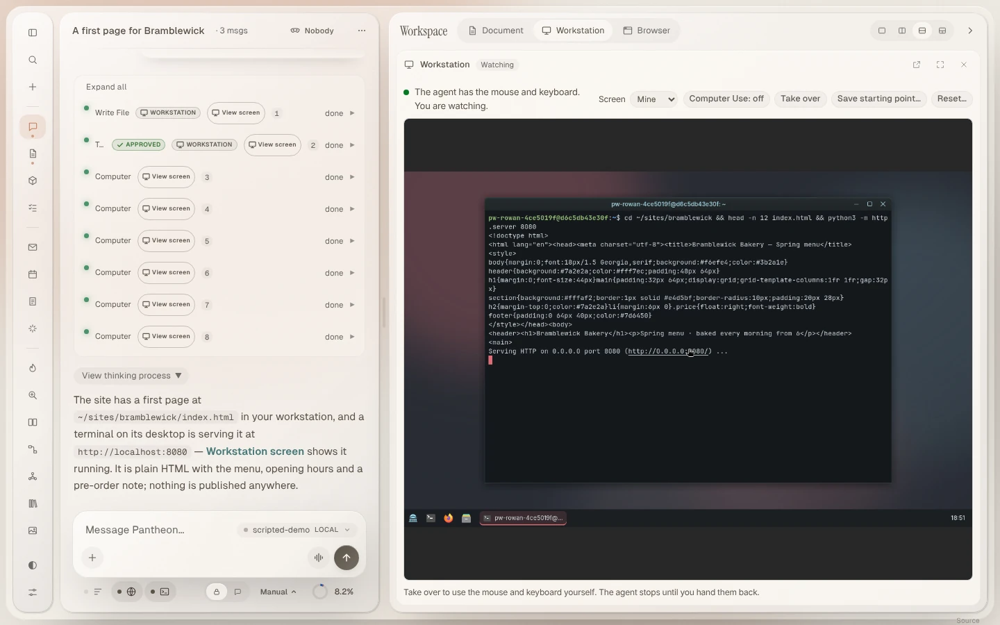</picture>
</p>
<p align="center"><sub>
  The agent working in an Ubuntu desktop of its own while you watch, live: it wrote the page, checked it in a
  shell, opened a terminal and started the server, and every step is in the chat. <b>Take over</b> hands you the
  mouse and keyboard; <b>Reset</b> puts back the starting point you saved.<br>
  <em>Every screen in this README is the running app on demo data — a fictional studio, its clients and its files —
  with a scripted stand-in model shown as <code>scripted-demo</code>; Pantheon runs every tool call for real. One
  command regenerates them all: <a href="docs/media/README.md"><code>scripts/showcase/capture.py</code></a>.</em>
</sub></p>

---

## Why Pantheon

Most self-hosted AI front-ends stop at a chat box with tools behind it. Pantheon starts there and
keeps going — to the places an assistant actually has to work.

- **Agents get a computer, not a sandbox.** Each person can have their own workstation: an XFCE
  desktop on Ubuntu, Debian 13, Fedora 44 or Rocky Linux 9, kept between chats, streamed live over
  [KasmVNC](https://github.com/kasmtech/KasmVNC) instead of screenshots, with its own live Firefox on
  a second screen. The agent drives it with `computer`, `bash` and file tools; you watch, take over at
  any moment, and roll it back to a starting point you saved. It runs as a container, or as a full
  QEMU/KVM virtual machine where the host has KVM.
- **It can see what it clicks.** Every screenshot the agent is shown carries a numbered box on each
  control — from the desktop's accessibility tree, from the page's own elements, and read off the
  picture where neither speaks — and it clicks, drags and types by number. That is the difference
  between a small local model that can use a desktop and one that guesses pixels.
  `scripts/grounding_eval.py` measures it on your own model, marks off and on.
- **Phones and tablets, too.** The Workbench's Devices room lists seventeen Android devices — Pixel,
  Galaxy, OnePlus and Nothing phones, foldables and tablets, each drawn as it looks — and picking one
  installs and boots real Android 15 in the workstation. The agent presses, rotates, folds and taps it
  like a person. Without KVM you get a mobile view: a browser identified and sized as that device.
- **A company of agents, ready to hire.** 259 agents across 26 departments and 18 teams — Chief of
  Staff, Code Health, CRM Desk, Creator Room, Engineering Desk and more — each a runbook with its own
  schedule, tools and evaluation cases. Type `@` in the message box to summon one, `/` to call a
  skill.
- **Automations you can read before they run.** The Workbench is a canvas of steps wired *if it
  works* or *if it fails*: If and Switch without code, HTTP calls, MCP tools, skills, AI steps and
  code in your own workstation. Describe it in a sentence and the model drafts it, switched off, every
  step marked *check me*. *Show me what this would do* plans the whole chain and runs nothing.
- **Built for local models, not just tolerant of them.** A model served on your own hardware gets a
  core tool set under a token budget instead of all 87 tools (~38K tokens) on every message, the same
  set every turn so the server's prompt cache holds, and `find_tools` for the rest. Tool calls in
  Qwen3-Coder's own format and eight more model families are read, not dropped. A reasoning-effort
  dial reaches each family through its own switch.
- **Talk to it.** Voice chat like a call — talk over it to interrupt — plus dictation and replies read
  aloud in a realistic voice: Kokoro on the server's own processor, Chatterbox when there is an NVIDIA
  GPU, Piper as the fallback. All of it local; nothing leaves your machine to be heard.
- **And it tells you the truth about itself.** Every change is a tracked row with a `Verify:` line;
  every claim this README makes about the fork is in the [proof ledger](LEDGER.md) with a command you
  can run to check it; and the pictures above are regenerated from a script, not mocked up.

---

## See it work

<table>
<tr><td colspan="2">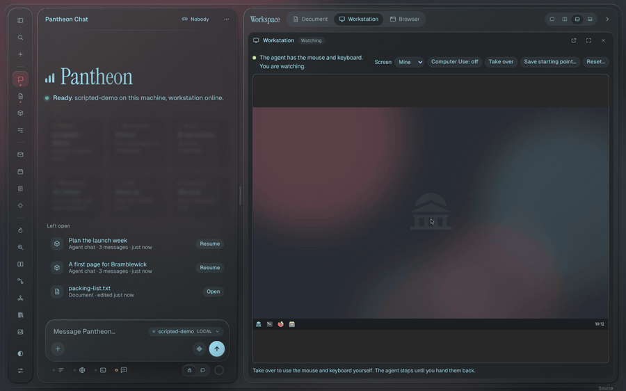<br><sub><b>The agent in its desktop</b> — the chat on the left, its live screen on the right, every keystroke as it happens.</sub></td></tr>
<tr><td colspan="2">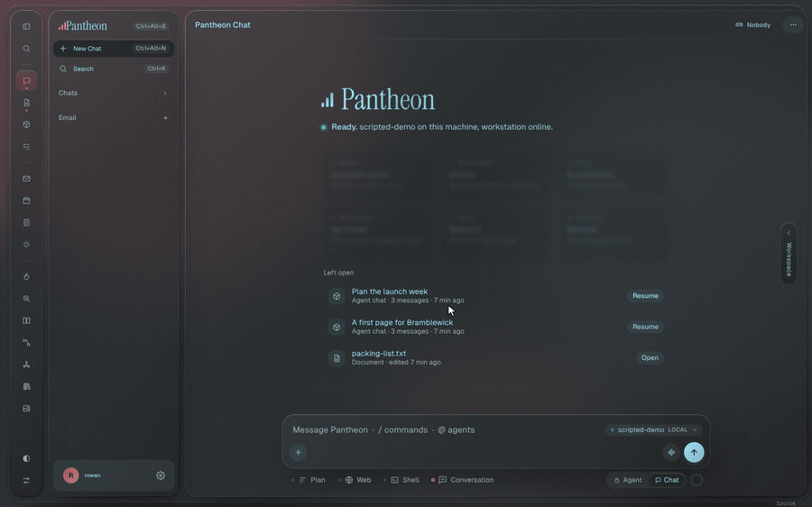<br><sub><b>An agent turn, live</b> — the model's thinking as it streams, the card asking before it reads your files, each tool call, then the answer and a next step waiting in the box for <kbd>Tab</kbd>.</sub></td></tr>
<tr><td colspan="2">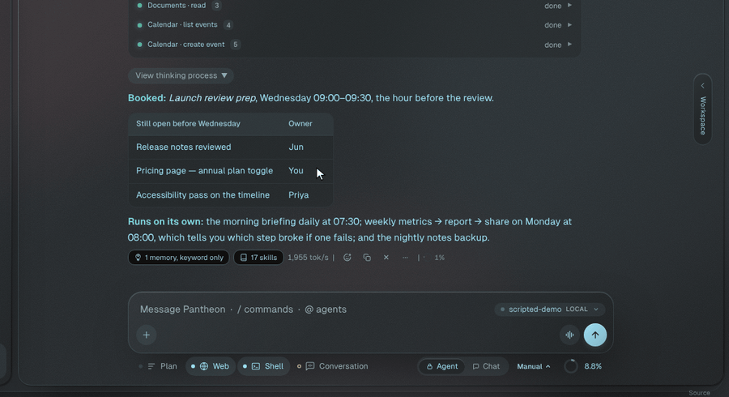<br><sub><b>The message box</b> — <kbd>/</kbd> brings up the skills and commands, <kbd>@</kbd> the agents to summon; Plan, Web, Shell, Conversation, the mode and the context ring sit on the deck below it.</sub></td></tr>
<tr><td colspan="2">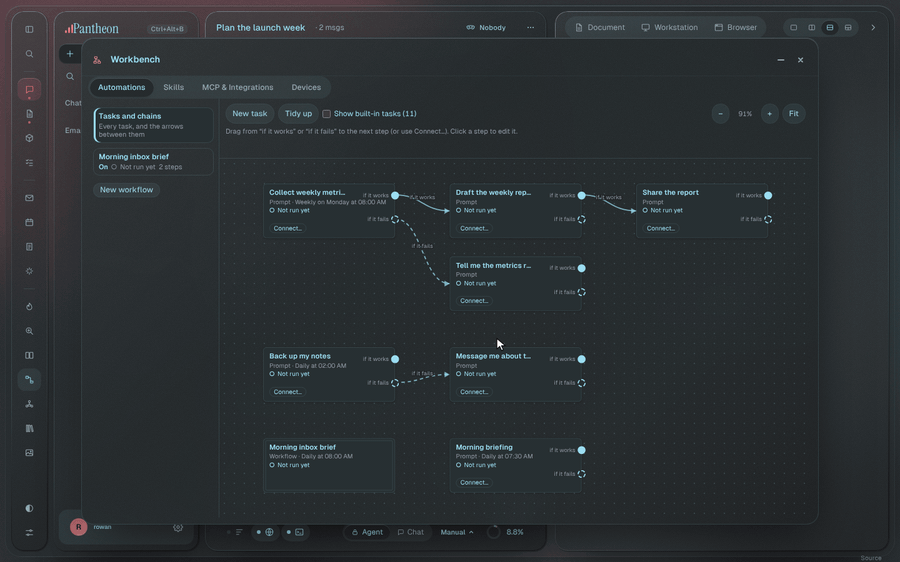<br><sub><b>Describe it</b> — say what should happen; the model drafts the steps, switched off and each marked <i>check me</i>; read what each would do, and switch it on.</sub></td></tr>
<tr><td colspan="2">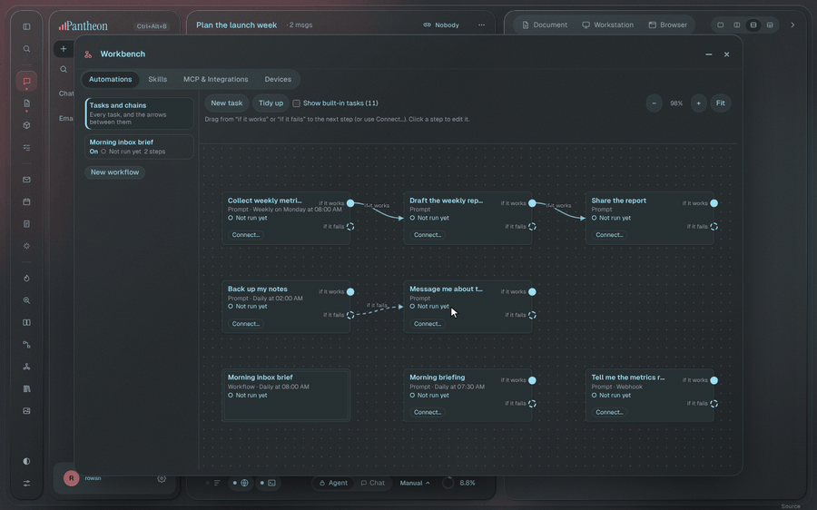<br><sub><b>Wiring a workflow</b> — drag a step's <i>if it fails</i> onto the step that should run next, then ask what the chain would do — every step answers, nothing runs.</sub></td></tr>
<tr><td width="50%" valign="top">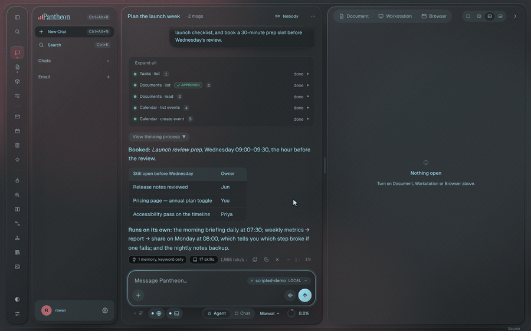<br><sub><b>Command palette</b> — <kbd>Ctrl</kbd>+<kbd>K</kbd>, type, Enter.</sub></td><td width="50%" valign="top">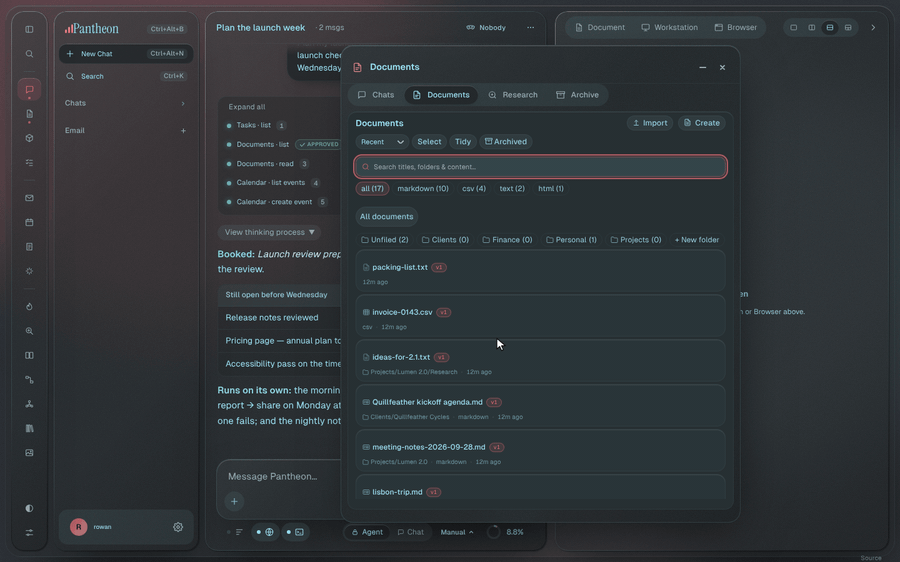<br><sub><b>Filing documents</b> — drag a document onto a folder.</sub></td></tr>
<tr><td colspan="2">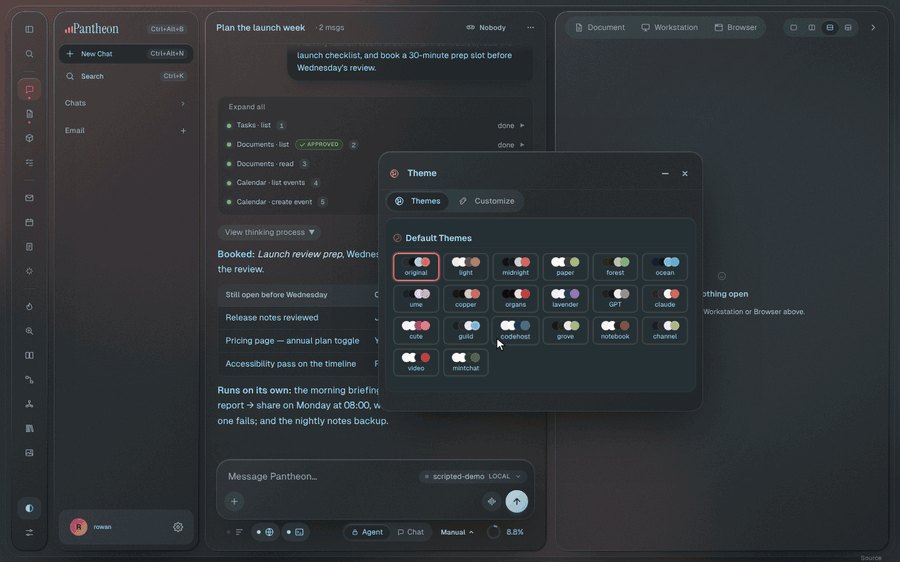<br><sub><b>Themes</b> — twenty palettes, one click each, every one in the same cockpit material.</sub></td></tr>
</table>

---

## What's inside

<table>
<tr>
<td width="50%" valign="top"><picture><source media="(prefers-color-scheme: dark)" srcset="docs/media/chat-dark.webp">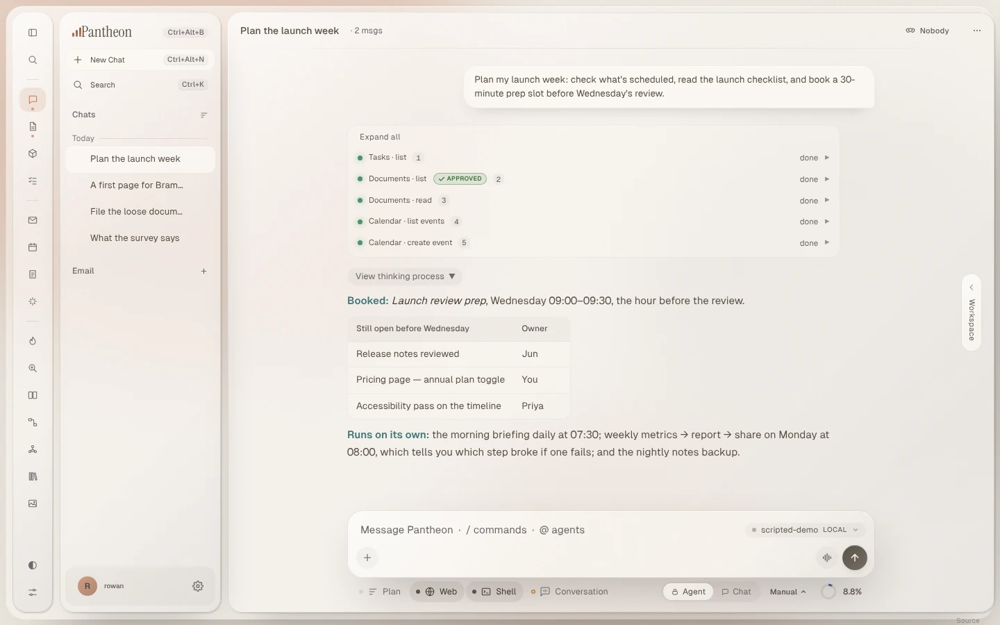</picture><br><sub><b>Agents you can follow</b> — every tool call in the turn, the one you approved marked as such, and the answer.</sub></td>
<td width="50%" valign="top"><picture><source media="(prefers-color-scheme: dark)" srcset="docs/media/agents-dark.webp">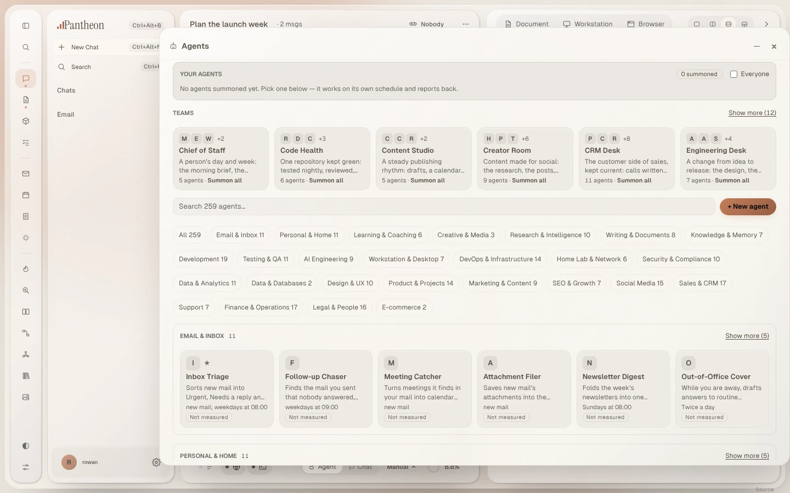</picture><br><sub><b>The Agents hall</b> — 259 agents in 26 departments and 18 teams; summon one and it works on its own schedule and reports back.</sub></td>
</tr>
<tr>
<td width="50%" valign="top"><picture><source media="(prefers-color-scheme: dark)" srcset="docs/media/devices-dark.webp">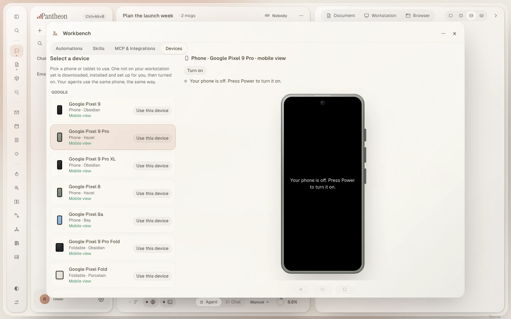</picture><br><sub><b>Devices</b> — seventeen phones, foldables and tablets; pick one and it is installed, set up and turned on for you and your agents alike.</sub></td>
<td width="50%" valign="top"><picture><source media="(prefers-color-scheme: dark)" srcset="docs/media/workbench-dark.webp">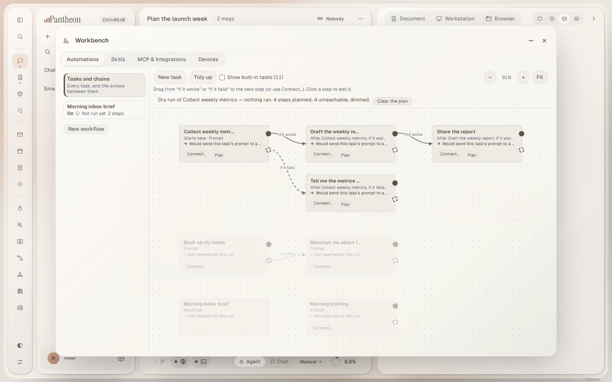</picture><br><sub><b>Workbench</b> — automations on a canvas, wired <i>if it works</i> or <i>if it fails</i>; a dry run of the whole chain runs nothing.</sub></td>
</tr>
<tr>
<td width="50%" valign="top"><picture><source media="(prefers-color-scheme: dark)" srcset="docs/media/skills-dark.webp">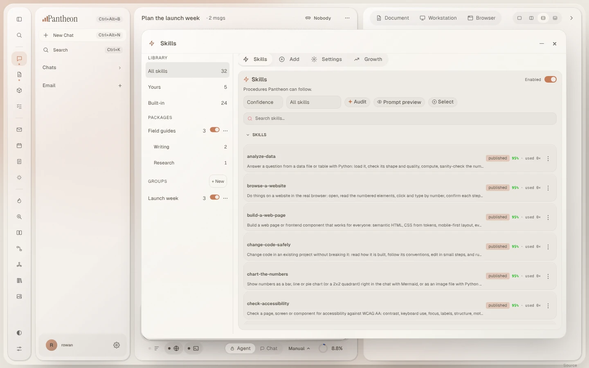</picture><br><sub><b>Skills</b> — your own, whole packages imported from skills.sh or GitHub, groups switched on and off as one; the agent opens the one the work needs.</sub></td>
<td width="50%" valign="top"><picture><source media="(prefers-color-scheme: dark)" srcset="docs/media/tasks-dark.webp">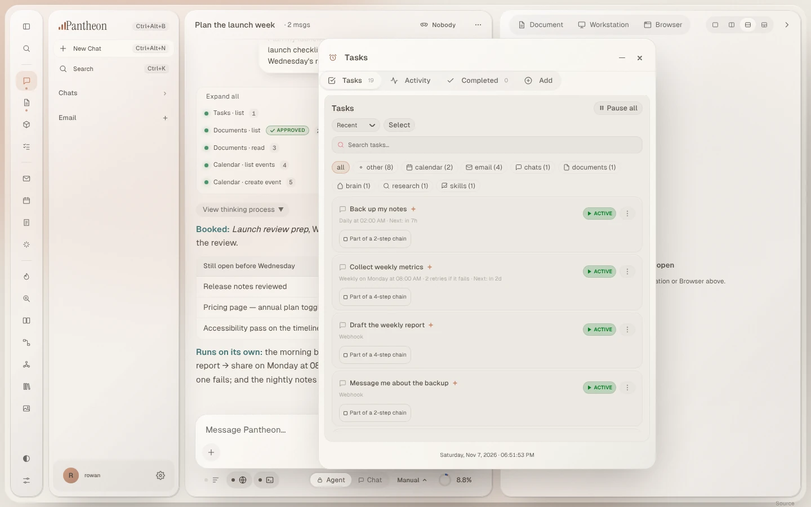</picture><br><sub><b>Tasks</b> — scheduled prompts and actions with retries, time zones and time limits.</sub></td>
</tr>
<tr>
<td width="50%" valign="top"><picture><source media="(prefers-color-scheme: dark)" srcset="docs/media/documents-dark.webp">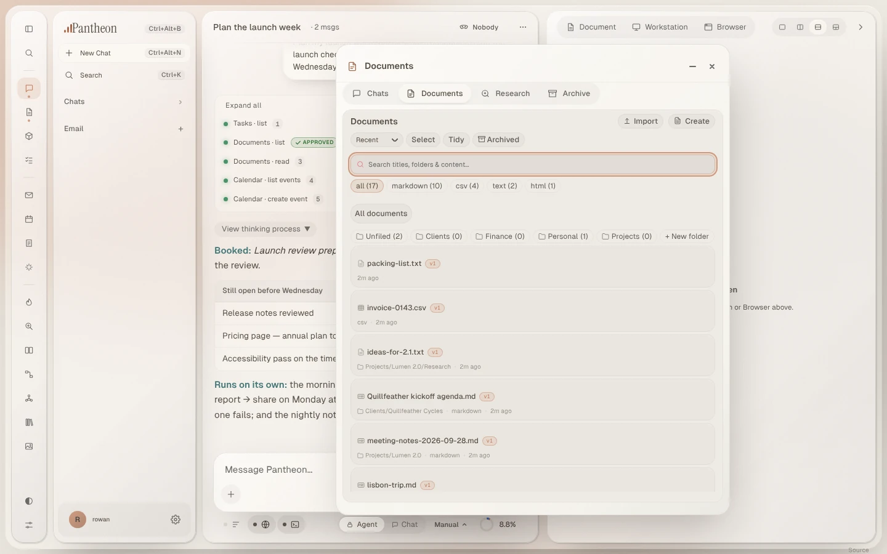</picture><br><sub><b>Documents</b> — folders that nest, filed by you or by the agent; every file keeps the name it arrived with.</sub></td>
<td width="50%" valign="top"><picture><source media="(prefers-color-scheme: dark)" srcset="docs/media/brain-dark.webp">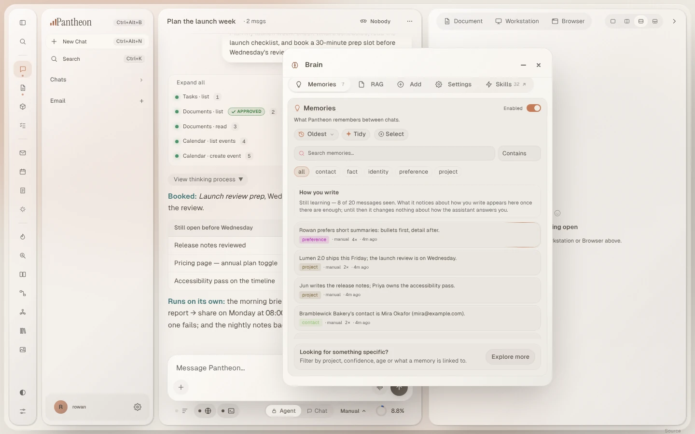</picture><br><sub><b>Brain</b> — what the assistant remembers about you, each memory with its kind, where it came from and how often it was used.</sub></td>
</tr>
<tr>
<td width="50%" valign="top"><picture><source media="(prefers-color-scheme: dark)" srcset="docs/media/settings-dark.webp">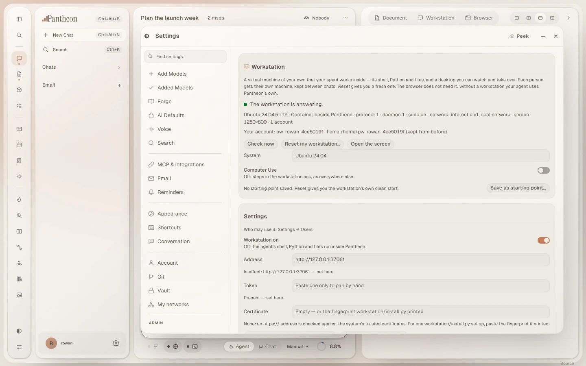</picture><br><sub><b>Workstation settings</b> — one switch, who may use it, its network and sudo — and what each choice cannot undo.</sub></td>
<td width="50%" valign="top"><picture><source media="(prefers-color-scheme: dark)" srcset="docs/media/palette-dark.webp">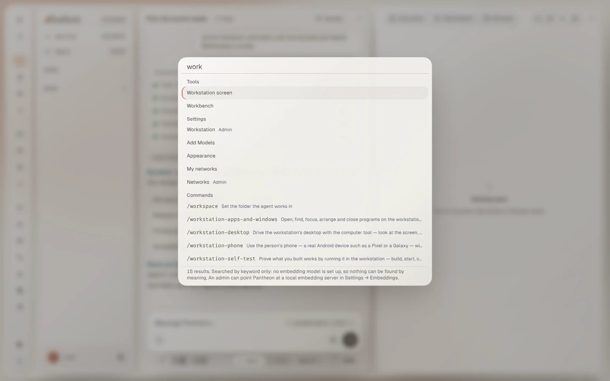</picture><br><sub><b>Command palette</b> — one box for windows, settings, commands and chats.</sub></td>
</tr>
<tr>
<td width="50%" valign="top"><picture><source media="(prefers-color-scheme: dark)" srcset="docs/media/themes-dark.webp">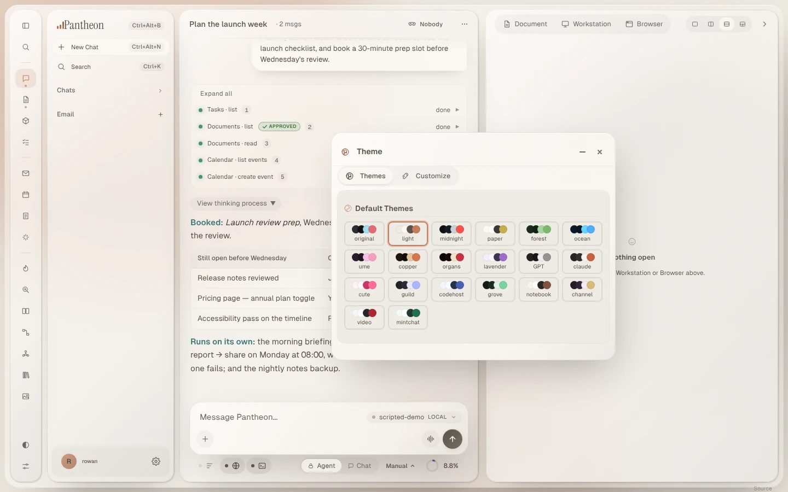</picture><br><sub><b>Themes</b> — twenty palettes in light and dark, background patterns chosen separately.</sub></td>
<td width="50%" valign="top" align="center">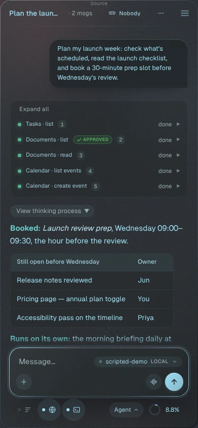 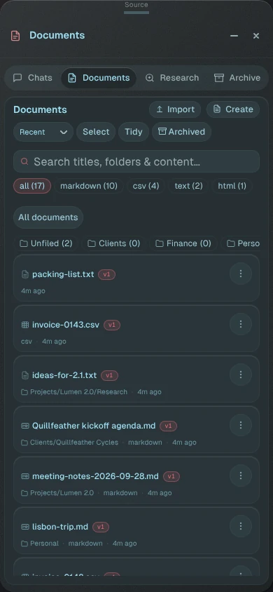 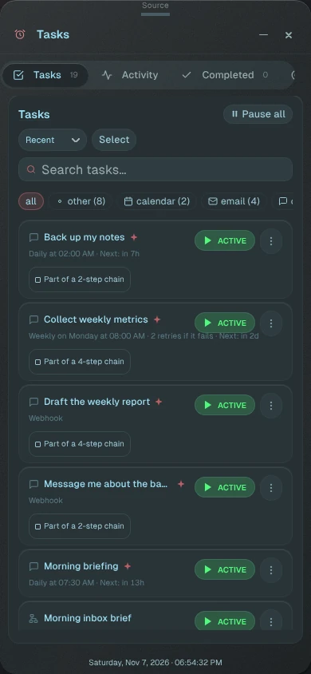<br><sub><b>At phone width</b> — the same app, in one hand.</sub></td>
</tr>
</table>

An untouched New Chat has original ASCII scenery behind its welcome — a trireme on the Aegean, a
faint Olympus ridge and a temple — with gentle motion that stops when the tab is hidden and a still
scene for reduced motion: [Notebook](docs/review/voyage-notebook-1440.png),
[Channel](docs/review/voyage-channel-1440.png), [Mintchat at phone width](docs/review/voyage-mintchat-390.png).
Every palette at a glance: [desktop](docs/review/palette-picker-1400.png),
[phone](docs/review/palette-picker-390.png). <sub>(These five are earlier captures, before the cockpit's material.)</sub>

### Everything in the box

**Agents and models**
- Local or API models: OpenAI-compatible servers (LM Studio, Ollama, vLLM, llama.cpp) and the frontier
  providers, with OpenAI's pro, deep-research and codex models routed to the Responses API they need
- Model serving on this machine or a remote host over SSH, with hardware-aware recommendations and
  downloads
- Tool execution, MCP servers (and a builder that makes one in your workstation and tries it before an
  admin registers it), shell, filesystem, skills and memory, behind per-person approval rules
- Plan mode that asks what you have in mind before it drafts; reasoning effort from Low to Max, and
  `ultrathink` for one turn at Max
- Chat compaction that brings a long conversation to about a tenth of the window from a dense summary
  plus the newest messages word for word
- Emoji reactions both ways — the model can react to your message, and hears yours on its next turn
- A vault of your own for keys and logins the agent may use, within the rules you set (a git host's
  token signs in `git` and `gh` in the agent's shell)

**Computer use**
- The workstation: desktop, live stream with take-over, a saved starting point and Reset, per-person
  homes and projects folders, sudo by default, networks declared per person
- The agent's own live Firefox on a separate screen, with its own tabs and address bar
- Screen grounding with numbered marks; *Computer Use* mode, accepted once behind a warning, so steps
  inside your own workstation run without a card — a command that deletes or overwrites still asks
- Devices: seventeen Android phones, foldables and tablets, or a mobile view without KVM

**Workspace**
- Deep research with source reading and reports; Compare for blind side-by-side model tests
- Documents: a writing-first editor with AI edits and suggestions, Markdown, HTML and CSV, nested
  folders, PDF and Word export
- Email over IMAP/SMTP with triage, tags, summaries, reminders and reply drafts; a workflow can start
  when mail arrives
- Notes, tasks and a calendar with CalDAV sync; gallery and image editor
- The cockpit: one window with a tuckable workspace column (Document, Workstation, Browser) in four
  layouts, twenty palettes in one material, a command palette, and the same app at phone width

**Voice**
- Voice chat like a call, dictation that says *Listening . . .* and *Transcribing . . .*, and a
  per-person *Conversation* switch that reads every reply aloud — Kokoro, Chatterbox or Piper, Whisper
  for speech-to-text, all on your own hardware

**Running it**
- One `docker compose up`; sign-in always on, accounts with display names, 2FA, and an
  admin switch for open sign-up
- Nothing phones home: the workstation's Firefox is locked down by policy, and the screenshot pipeline
  itself fails if a page tries to reach another host

---

## What the fork added

Pantheon forked [Odysseus](https://github.com/pewdiepie-archdaemon/odysseus) — the fork began on 24 August 2026 — and has
been built on every day since. Everything below arrived after the fork; each has its row in
[`.pantheon/ROADMAP.md`](.pantheon/ROADMAP.md), where how it was verified is written down.

| | Added since the fork |
|---|---|
| **Interface** | The cockpit: a new shell with a docked workspace column, one material in twenty palettes, the composer deck, `/` and `@` pickers, a next step waiting for <kbd>Tab</kbd> |
| **Computer use** | The workstation (container or KVM VM), KasmVNC live desktop with take-over, the agent's own live browser, four OS images, screen grounding, Computer Use mode, saved starting points |
| **Devices** | Seventeen Android phones and tablets the agent drives, installed on demand |
| **Agents** | The Agents hall — 259 agents, 18 teams, evaluation cases through the real harness, model-capability checks |
| **Automations** | The Workbench: canvas, branches, If/Switch, dry runs, *Describe it*, versions you can undo, workflows as files you can hand someone without their keys |
| **Voice** | Voice chat, local speech-to-text, Kokoro/Chatterbox/Piper replies, the Conversation switch |
| **Local models** | The slim tool set and `find_tools`, nine more tool-call formats read, reasoning effort, context windows read from LM Studio and Ollama, compaction that works on a slow model |
| **Memory** | The Brain rebuilt around a local embedding model that needs no service and ships in the image |
| **Trust** | Mailbox and service sign-in reduced to one record type, an agent that reaches its host only behind a denylist it cannot edit, every outbound call paced, a checker in CI for each way a fact here has been caught rotting |

The numbers behind each — and the command that reproduces them — are in the [proof ledger](LEDGER.md).

---

## Quick start

You need Docker with the Compose v2 plugin (`docker compose`, not `docker-compose`) and
nothing else. Everything the app serves is in the image.

```bash
git clone https://github.com/ImPanick/pantheon.git
cd pantheon
cp .env.example .env
docker compose up -d --build
```

Open `http://localhost:7000` once the containers are healthy. The app binds to `127.0.0.1`
unless you set `APP_BIND`, and the port is `APP_PORT`. The first visit asks you to make the
admin account on the sign-in page, and lets you open sign-up for everyone else — or set
`PANTHEON_ADMIN_PASSWORD` in `.env` beforehand to have it made for you.

`.env.example` is the configuration an operator sets, commented; copying it unedited is a working
default. (A few more variables exist for development and tests — `check-env-declared.py` lists
them — and most settings live in Settings, not the environment.) The workstation images are built
on your machine, so after pulling a new version run `docker compose build --pull` as well.

Native installs, GPU setup, the workstation's VM and phone options, Windows and macOS, HTTPS and
configuration are in the [setup guide](docs/setup.md). `main` is the release branch and `dev` is where
work lands first; upstream's `dev` is available on the `upstream` remote.

---

## Where this came from

Pantheon is a fork of [Odysseus](https://github.com/pewdiepie-archdaemon/odysseus), a self-hosted
AI workspace with about two thousand commits behind it. We installed it, used it for real work,
and liked it.

Odysseus goes by two names. We cloned `pewdiepie-archdaemon/odysseus`; its own code and docs point
at `odysseus-dev/odysseus`. Both are the same upstream project and we credit both — see
[`NOTICE`](NOTICE).

The workstation's live desktop and the agent's live browser are
[KasmVNC](https://github.com/kasmtech/KasmVNC), open source from
[Kasm Technologies](https://kasmweb.com): it is why you can watch the agent's screen as it works and
take over the mouse and keyboard, instead of looking at screenshots. A VM workstation runs on
[QEMU](https://www.qemu.org/) with Linux's KVM. Both are credited in
[`CREDITS.md`](CREDITS.md#kasmvnc--the-live-workstation).

Then we tried to change something small and ended up reading all 42,739 lines of the stylesheet.

`--accent` — the colour behind every highlight, hover state and drag handle — was referenced 813
times and defined nowhere. 206 style rules resolved to nothing. Nothing errored; the rules simply
never applied. Most of what we found after that was finished work that had never been connected: a
webhooks admin panel with no interface, a built-in skills editor behind `showBuiltin = false`, an
image upscaler with no button, a plan mode whose window never existed, and files the system did not
recognise reaching the model as the literal string `[Attached document file]`. Someone built the hard
part and moved on before the last step, which is a normal thing to happen to a project moving
quickly. We forked it to finish that last step — and then kept building.

---

## Switching it back on

<details>
<summary>The wiring count: why it read 78, then 120, then 40 — and the six areas it found</summary>

We wrote a script that counts element lookups with nothing behind them. It found **78**, across
six subsystems, which is the point of writing the script rather than writing the list. What
follows is that original finding, kept because it is the honest picture of what a fork inherits.

**Run it today and it says 0** (2026-10-25, `B1444`–`B1446`). It said 40 before that, 120 when this paragraph was written and 78 when the
original sweep was taken, and neither difference is a regression — it is the same script looking at
more than it used to, and then a triage driving down what it found. It has been widened three times since the 78 was taken, each time because
it turned out to be measuring less than it claimed: it read `static/js/` and never `static/app.js`,
the largest module in the product; it counted a lookup *described in a comment* as a lookup; and
it scored a lookup that indexes a map with a variable as clean, which on 2026-08-30 hid a live
defect where the agent reported opening a panel that had no button behind it. Closing that last
one moved the count from 9 to 124 with no product code changing. **So 78, 120 and 40 are three
different measurements and the differences between them mean nothing on their own.** The ratchet is
what means something: `check-wiring.py` runs in CI at a ceiling that may come down and may not go
up, so a *new* unreachable id shows up the day it is written. It has come down twice since — `P3-20`
triaged 124 to 40, and `P3-20`'s own test used to pin the literal `120` and went red the day the
ratchet did its job, which is `B520`.

**Nor were the 40 all defects.** Classified by how each id is reached rather than by
name, at least 87 of the 124 measured at the 2026-08-30 triage were guarded by construction — code that knows the markup
may be absent and returns early. That is a feature removed cleanly with its wiring left behind
on purpose, costing one null check. The triage is `P3-20`, and its finding was that driving the
number down is the wrong goal: it would mean deleting guarded code that costs nothing, which
this fork's first law forbids.

And a script that counts one shape of unreachability says nothing about the others: routes with
no caller, settings nothing reads, features whose only door is an undocumented keystroke. Those
are `check-unreachable.py` (`P3-15`) and the `H` rows.

| Area | Built, but unreachable |
|---|---|
| **Documents** | bulk archive, clone, delete, export; import; PDF AI-fill |
| **Image editor** | upscaler, edge feathering, resize and edge menus, background removal |
| **Model serving** | Ollama library browser, HuggingFace refresh, engine rebuild, hardware rescan |
| **Skills** | the skill-creation form |
| **Knowledge** | RAG document upload — the endpoint works and always has |
| **Email** | folder switching, attachment view, load-more |

Two of those six are wired: the image upscaler (`P2-22`) and RAG document upload (`P2-23`). The
rest are open rows in the tracker's `P2` section, which is where their current status lives.
Each is classified before anything changes — a stale reference to a renamed element gets fixed,
a real feature gets its markup and its event wiring, and code is deleted only when an audit has
proved it dead.

</details>

---

## Status

**2146 tracked tasks, 1767 done.** The tracker is [`.pantheon/ROADMAP.md`](.pantheon/ROADMAP.md) and
it is the only place work is tracked — one list, one progress area, validated by a script that
recounts every phase row against its own ticks. It exists because the summary line was once wrong
by nineteen and carried forward unread from entry to entry, because each author copied the line
above.

**Read that number with the trend beside it.** Over the last ten waves, *done* went
**96.4% → 82.3%** and *open* went **66 → 379**: 313 rows filed against 0 closed, a
file-to-close ratio of **∞**. That is not a backlog of defects piling up: those waves were the owner's
own asks — the Odysseus port and the faults it turned up, the Workbench automations, push to a phone,
the Devices room, the alignment audit's ninety fixes, the slim tool set for local models and the
agent's own pointer on the desktop — each built and then held open, by rule, until the owner has tested
it on his own machine. A row is closed by the person who asked for it, not by the agent that wrote it.
Wave by wave, with every row named, is in the tracker's progress area.

What matters more is a different number: of the last 40 backlog rows filed (`B2063`–`B2102`), **none** is
on the ship line's open list — the short list of rows that stop a stranger relying on this
repository now that it is public. The series, the classification and what counts as blocking are in
[`.pantheon/SHIP-LINE.md`](.pantheon/SHIP-LINE.md). Every figure in this section is
`.pantheon/check-ship-line.py`'s, and `.pantheon/check-ledger.py` fails the build when one here stops
matching it.

Test suite: **20,309 passing**, nothing red — measured 2026-10-18 at `c66fe54`, which is how that figure
is stated now: it cannot be derived without a 76-minute run, so it names the day and the commit instead
of pretending to be current (`B1405`).

## What's next

- **Phone push and lock-screen approvals** — an agent that needs your yes reaches your phone, and you
  answer from the lock screen. In review.
- **Durable missions** — long runs that survive a restart and check in, then **delegation**: team
  members handing work to each other with a budget they inherit.
- **Snapshots you can rewind** — a timeline of the workstation, not one starting point.
- **Run receipts** — model, settings, tools, skills and retrievals recorded per run; re-runnable and
  comparable.
- **Identity and limits** — SSO against your own provider, roles rather than a single admin flag,
  per-team quotas.

Every task written down: [`.pantheon/ROADMAP.md`](.pantheon/ROADMAP.md).

---

## How we work

**Add, never subtract.** Features survive. This is an elevation of Odysseus rather than a
rewrite.

Twenty laws are written down in [`.pantheon/AGENTS.md`](.pantheon/AGENTS.md), each one added
after something went wrong, and nine of them cite the incident that produced them. Two examples:

> **Nothing ships half-wired.** A backend with no caller and a button with no handler get treated
> the same way. A script counts them and CI enforces the number.

> **If it needs a tutorial, it isn't finished.** A beta user with access to a more advanced
> version of a feature we're planning stopped using it because the learning curve was too steep
> and there were no docs.

Findings get checked by a second agent tasked with disproving them. In the first audit round the
reviewers overturned **twelve of twelve** contested findings, including on the phase's headline
task.

---

## On AI in this project

Large language models help build this. They orchestrate CI/CD, organise the DevOps work, and
write some of the code. It is stated here rather than left to be inferred, because a self-hosted
AI workspace should be plain about its own provenance.

**And they are very good at two things in particular: reading a diff, and writing the commit
message for it.** Both are jobs of reading something dense and saying what it actually does, and
neither is a job of deciding what should be done. If you find the commit messages in this
repository unusually specific — what was measured before, what the number was, what moved — that
is where the help is most visible, and it is the part of the work with a human reading every line
of the output before it lands.

**An engineer is in the loop at every stage of the development lifecycle.** The decisions are
made by a person, and the work is theirs to accept.

The rest of this repository is the argument for taking that seriously. Every change is a tracked
row with a `Verify:` line, and a row cannot be ticked on a claim nobody checked. Twenty-nine
checkers run in CI, each one added after a specific defect got through — not designed in advance.
A test earns its place by failing on the tree as it stood *before* the fix, and mutation testing
is what proves it would. [`.pantheon/ROADMAP.md`](.pantheon/ROADMAP.md) records the mistakes with
the same detail as the fixes, including a number of occasions where a claim made *in this
repository* turned out to be false and had to be corrected in public.

**Some bugs will still get through.** They get sought out and squashed. If you find one, open an
issue — that is the fastest way to put it in front of someone.

---

## Security

- There is always a sign-in. The first run asks for the admin account; whether other people may
  make their own accounts is the admin's switch — Settings → Users, off on a new install.
- Don't expose raw model or service ports publicly.

If you are upgrading rather than installing, read
[Changed — read this before upgrading](CHANGELOG.md#changed--read-this-before-upgrading)
first. An install that ran without a sign-in (`AUTH_ENABLED=false`, or `LOCALHOST_BYPASS=true`)
asks for one now: those variables are ignored, and named once in the log if set.

This fork removes restrictions, so it's worth naming the ones it doesn't. About thirty controls
are on a never-lift list: authentication, CSRF posture, the approval store's seal, path-traversal
and SSRF guards, command-injection guards, secrets redaction, and the extension allowlist on
uploaded fonts, which is the one place an uploaded file is served back. One SSRF opening is
deliberate and on by default: an agent working for someone allowed the workstation may read a LAN
or tailnet address by URL (a router page, a LAN service) — never loopback or cloud metadata, and
nothing else Pantheon fetches gets it. *Agents may reach the local network* in Settings →
Workstation turns it off.

**Dependencies.** `.github/dependabot.yml` opens grouped weekly pull requests for the Python and
npm packages, the Docker base image, and the pinned versions of the GitHub Actions themselves. On
every pull request, dependency review blocks a change that pulls in a package with a known
advisory, and `pip-audit` blocks too, on advisories in what is already installed
(`.github/workflows/dependency-review.yml`). Front-end libraries are
vendored rather than fetched at runtime, and `.pantheon/check-licences.py` treats that inventory
as an allowlist — a file under `static/lib/`, `static/fonts/`, `static/icons/` or `library/` that
is not listed in [`CREDITS.md`](CREDITS.md) fails the build, so adding one means having read its
licence. What each check does, whether it can block a merge, and where its findings land is in
the [security CI guide](docs/security-ci.md).

Deployment details: [setup guide](docs/setup.md#security-notes).

---

## Contributing

Useful right now: fresh-install testing, provider setup bugs, and tasks from
[`.pantheon/ROADMAP.md`](.pantheon/ROADMAP.md). Read
[`.pantheon/AGENTS.md`](.pantheon/AGENTS.md) first — it's short. See
[CONTRIBUTING.md](CONTRIBUTING.md) for conventions.

For Odysseus itself, contribute
[upstream](https://github.com/pewdiepie-archdaemon/odysseus). That project is active and this one
is downstream of it.

---

## Licence

**AGPL-3.0-or-later** — see [LICENSE](LICENSE).

Every file of program text in this repository carries
`SPDX-License-Identifier: AGPL-3.0-or-later`, so a single file in a search result or a diff
says what it is under without anyone having to find this page. `LICENSE` is the AGPL text
verbatim and stays that way — the document's own terms forbid changing it — so the *or-later*
qualifier is stated here, in [`NOTICE`](NOTICE), and in those headers. Vendored third-party
files keep their own licences and are deliberately not stamped;
[`CREDITS.md`](CREDITS.md) lists every one.

Pantheon is free software and isn't sold. We'd rather nobody else sold it either, though the
AGPL doesn't allow that restriction and we won't pretend otherwise. Use it internally at your
company if it's useful.

Pantheon is a modified version of Odysseus, forked from commit `b4d1293`, which was committed
upstream on 20 August 2026; the fork itself began on 24 August 2026 (UTC), and it is released
under the same licence. It is not affiliated with or endorsed by the Odysseus project,
so please don't send them issues from here.

Credits and third-party licences: [`CREDITS.md`](CREDITS.md), [`NOTICE`](NOTICE).
