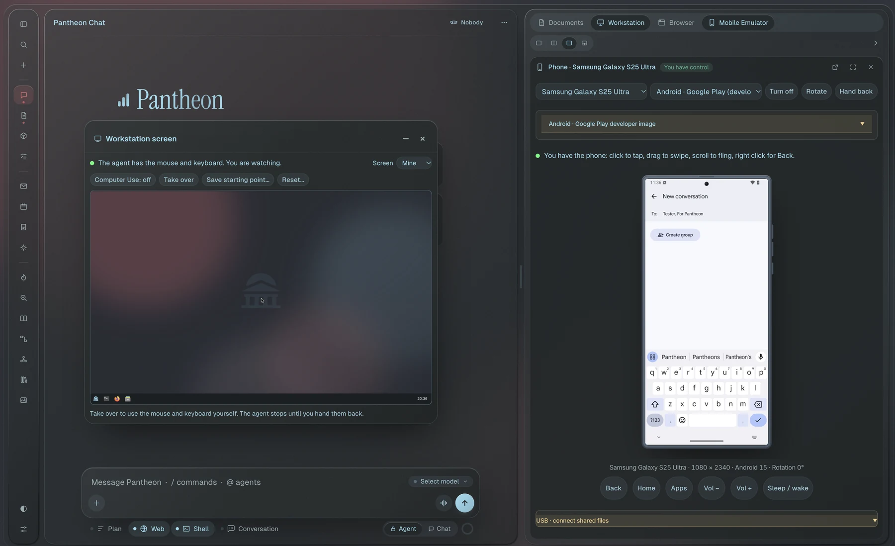

<h1 align="center"><picture><source media="(prefers-color-scheme: dark)" srcset="docs/brand/pantheon-lockup-dark.svg"></picture></h1>

<p align="center">
  <strong>Your agent gets its own computer, and its own phone.</strong><br>
  Pantheon is a self-hosted AI workspace. The agent works in a Linux desktop and on a real Android
  phone while you watch, and you can take either one back whenever you want. It runs on hardware
  you own, against the models you choose.
</p>

<p align="center">
  
  
  
</p>

<p align="center">
  <a href="https://github.com/ImPanick/pantheon/actions/workflows/ci.yml?query=branch%3Amain"></a>
  <a href="https://github.com/ImPanick/pantheon/actions/workflows/secret-scan.yml?query=branch%3Amain"></a>
  <a href="https://github.com/ImPanick/pantheon/actions/workflows/workflow-security.yml?query=branch%3Amain"></a>
  <a href="https://github.com/ImPanick/pantheon/actions/workflows/dependency-review.yml?query=branch%3Amain"></a>
  <a href="https://github.com/ImPanick/pantheon/actions/workflows/container-scan.yml?query=branch%3Amain"></a>
</p>

<p align="center">
  <a href="#why-pantheon-exists">Why</a> ·
  <a href="#a-real-phone-not-a-mobile-view">The phone</a> ·
  <a href="#a-memory-that-actually-recalls">The memory</a> ·
  <a href="#what-else-it-does">What else</a> ·
  <a href="#quick-start">Quick start</a> ·
  <a href="LEDGER.md">Proof ledger</a> ·
  <a href=".pantheon/ROADMAP.md">Roadmap</a> ·
  <a href="docs/setup.md">Setup guide</a>
</p>

<p align="center">
  
</p>
<p align="center"><sub>
  Android 15 on Google's own emulator, live beside the chat. In this shot you have the phone: click to
  tap, drag to swipe, right click for Back. Hand it back and the agent has it again.
  <em>Captured from the dev build on a Mac. Android needs a hardware hypervisor, which the automated
  screenshot run below doesn't have.</em>
</sub></p>

<table>
<tr>
<td width="50%" valign="top"><picture><source media="(prefers-color-scheme: dark)" srcset="docs/media/workstation-dark.webp"></picture><br><sub><b>The desktop.</b> The agent wrote a page, checked it in a shell and started a server in a terminal, in a Linux desktop of its own, while you watch.</sub></td>
<td width="50%" valign="top"><picture><source media="(prefers-color-scheme: dark)" srcset="docs/media/workbench-dark.webp"></picture><br><sub><b>The Workbench.</b> Automations as a graph of steps, with a failure branch and a dry run that runs nothing.</sub></td>
</tr>
</table>

<p align="center"><sub>
  Every screen above except the phone is the running app on demo data, a fictional studio with its
  clients and files, driven by a scripted stand-in model shown as <code>scripted-demo</code>. The tool
  calls are real. One command regenerates them: <a href="docs/media/README.md"><code>scripts/showcase/capture.py</code></a>.
</sub></p>

---

## Why Pantheon exists

Most AI tools give the model a chat box and a list of API calls. That gets you a long way, right up
until the work lives somewhere without an API: a settings page, a web app behind a login, an app
that only exists on a phone. People do that work with a screen, a keyboard and a thumb. In
Pantheon, so does the agent.

It started as a fork of [Odysseus](https://github.com/pewdiepie-archdaemon/odysseus). I used it and
liked its shell, but underneath it was a chatbot with a few half-baked automations, plus a lot of
finished work nobody had wired up: panels with no button, an upscaler with no menu, a plan mode with
no window. I was stuck in a creative rut on another project at the time, so this became the new
one. I connected what was there, then set out to build what would actually be useful to people:
the desktop first, then the phone, then everything an agent needs around them to get real work
done.

It's free, it's AGPL, and it isn't for sale. It runs on your machine, you pick the models, and the
third-party code it ships is pinned, vendored and licence-checked in CI instead of pulled at
runtime.

---

## A real phone, not a mobile view

When the agent needs a phone, Pantheon boots one. It's Google's Android Emulator running Android
15 (API 35), accelerated by the host's own hypervisor: Hypervisor.Framework on macOS, WHPX on
Windows, KVM on Linux. It isn't a desktop browser shrunk to phone width, and it isn't a rented
device in somebody else's cloud.

- **One phone per person.** Each person gets their own SDK home, ADB keys, console token and
  emulator. The pairing token stays with the app; neither the desktop nor the phone ever sees it.
- **You and the agent share the device.** It sits live next to the chat. Click to tap, drag to
  swipe, scroll to fling, right click for Back. Take it over, hand it back.
- **The agent drives it like a person would.** The same `computer` tool it uses on the desktop
  works on the phone: taps, swipes, Back and Home, the side keys, rotate, fold and unfold, open a
  URL, switch to another device. Each screenshot it gets comes with numbered marks read from
  Android's own UI tree, so it taps the button, not a pixel it guessed at.
- **Nineteen device profiles.** Pixel, Galaxy, Razr, OnePlus and Nothing phones, foldables and
  tablets, each with its own screen size, posture and frame. The profile sets the hardware shape;
  the OS is Google's Android in every case, not One UI or another vendor's build.
- **Files move both ways.** A USB-style shared folder links your projects folder to
  `Download/PantheonUSB` on the phone, for you and for the agent.
- **Locked down by default.** Secure ADB is checked at boot, scrcpy-server has to match a pinned
  SHA-256 before it runs, the emulator gets its own ADB server instead of sharing yours, and a
  phone host on another machine needs TLS with a pinned certificate.

| Where it runs | Accelerator | State |
|---|---|---|
| macOS on Apple Silicon | Hypervisor.Framework | Accepted on real hardware: boot, image switching, live input, file transfer |
| Windows | WHPX | Built; acceptance on a real Windows host still open |
| Linux | KVM | Built; acceptance on a real Linux host still open. Also runs inside a workstation VM with nested KVM |
| No hardware acceleration | none | No Android. You get a mobile browser view instead, and it says so |

The phone runs on a small host worker outside Docker, because that's where the hypervisor is.
Setting it up: [Android host guide](docs/android-host.md).

---

## A memory that actually recalls

The Brain is what Pantheon learns about you as you use it: preferences, projects, people, facts.
Every memory shows where it came from and how often it's been used, and you can read all of it. I
rebuilt it around a local embedding model that ships in the image, so it needs no extra service and
no network.

On the retrieval test set, putting the right memory first went from an MRR of **0.319** with
Odysseus's keyword search to **0.931**. That's nearly three times better, a 192% gain, and it
matters because memories are injected into a limited number of slots: a right answer ranked fifth
might as well not be there.

| Retrieval test set | MRR | recall@5 |
|---|---|---|
| Odysseus, keyword search (BM25) | 0.319 | 0.40 |
| Pantheon, local embeddings | 0.931 | 1.00 |

The test set is a fixture, not anyone's real memories, and the
[proof ledger](LEDGER.md#memory-and-retrieval) says so next to the number. To score it on your own
data, `.pantheon/retrieval_eval.py --generate` builds a test set from your memories.

---

## What else it does

- **Full computer use for any model that can see.** Any model with vision, tool calling and
  reasoning can drive the desktop and the phone: mouse, keyboard, windows, its own Firefox, taps and
  swipes. Pantheon supplies the tool and the screen, so you aren't tied to one vendor's
  computer-use API. From testing, run something larger than 12B. At 8B, 4B and below, models tend to
  avoid the computer-use tool and fall back to shell commands and web fetches instead of moving the
  mouse.
- **Automations you can talk into existence.** Say "every morning at 7:30, summarize my unread
  mail" and it sets up the task. Say "when this finishes, do that and then this" and it drafts a
  whole workflow. Or build one by hand in the Workbench: drag from a step's port onto the next step
  to wire it, on success or on failure, much like n8n. If and Switch need no code, and steps can be
  HTTP calls, MCP tools, skills, model calls or code in your workstation. A drafted workflow arrives
  switched off with every step flagged for you to check, a dry run plans the chain without running
  it, and when a step fails the model tells you why and offers a fix you can apply.
- **Skills it learns as you work.** After a chat that took real work, it writes down how it got
  there as a skill, and the ones it's at least 85% sure of come back on their own the next time
  they fit. You set that bar, or approve each one yourself, under Brain → Skills. Ask in chat and it
  writes, edits and publishes a skill on the spot. When a model is stuck it can ask a stronger one
  and keep the answer as a skill.
- **MCP servers it writes for itself.** Name the tools you want and Pantheon sets up an MCP server
  in your workstation for you and the agent to fill in. It starts the server, completes the
  handshake and lists the tools to prove it works. An admin registers it from a list without
  retyping anything (on your own install, that's you), and from then on the agent can call it. The
  agent can't register a server itself, on purpose: text it reads must never become a program it
  runs.
- **259 agents to hire.** 26 departments and 18 teams, each agent a runbook with its own schedule,
  tools and evaluation cases. `@` in the message box summons one, `/` calls a skill. The roster is
  growing: more agents are coming, and the ones already here keep getting sharper.
- **A desktop of its own.** XFCE on Ubuntu 24.04, Debian 13, Fedora 44 or Rocky Linux 9, kept
  between chats and streamed live over [KasmVNC](https://github.com/kasmtech/KasmVNC). The agent
  uses the mouse, keyboard, shell and files; you watch, take over, or reset it to a starting point
  you saved. It runs as a container, or as a full QEMU/KVM VM where the host has KVM.
- **Screens it can actually read.** Every screenshot the agent sees has a numbered box on each
  control, from the accessibility tree, the page's own elements, or the image itself where neither
  says anything. It clicks by number instead of guessing pixels, and `scripts/grounding_eval.py` measures the
  difference on your own model.
- **Local models first, any model you like.** A local model gets a small core tool set under a
  token budget instead of every tool on every message, the same set each turn so the server's
  prompt cache holds, and `find_tools` for the rest. Tool calls in Qwen3-Coder's format and eight
  other families are parsed, not dropped. Or bring an API key, or sign in with a ChatGPT or GitHub
  Copilot subscription.
- **Approve from your lock screen.** When the agent needs your yes for a step, the request reaches
  your phone or desktop as a push notification, even with Pantheon closed.
- **Voice.** Talk to it like a call and cut it off mid-sentence. Kokoro, Chatterbox or Piper speak,
  Whisper listens, and all of it runs on your hardware.
- **The rest of a workspace.** Mail over IMAP/SMTP with triage and reply drafts, documents, notes,
  tasks, a CalDAV calendar, deep research, Compare for blind side-by-side model tests, image
  generation and editing, a vault for the keys and logins the agent may use, model serving with
  hardware-aware picks, twenty themes, and the whole app at phone width.

The full list, and what the fork added over Odysseus, is in [docs/features.md](docs/features.md).

<table>
<tr><td colspan="2"><br><sub><b>The agent in its desktop.</b> Chat on the left, its live screen on the right, every keystroke as it happens.</sub></td></tr>
<tr><td colspan="2"><br><sub><b>Describe it.</b> One sentence in, three steps out, switched off until you've read what each one would do.</sub></td></tr>
<tr>
<td width="50%" valign="top"><picture><source media="(prefers-color-scheme: dark)" srcset="docs/media/agents-dark.webp"></picture><br><sub><b>The agents.</b> 259 of them in 26 departments and 18 teams.</sub></td>
<td width="50%" valign="top"><picture><source media="(prefers-color-scheme: dark)" srcset="docs/media/chat-dark.webp"></picture><br><sub><b>A turn you can follow.</b> Every tool call, the one you approved, and the answer.</sub></td>
</tr>
<tr>
<td width="50%" valign="top"><picture><source media="(prefers-color-scheme: dark)" srcset="docs/media/devices-dark.webp"></picture><br><sub><b>Devices.</b> Pick a phone, foldable or tablet and it's installed and turned on for you and your agents.</sub></td>
<td width="50%" valign="top"><picture><source media="(prefers-color-scheme: dark)" srcset="docs/media/settings-dark.webp"></picture><br><sub><b>Workstation settings.</b> Who can use it, its network, sudo, and what each choice can't undo.</sub></td>
</tr>
</table>

<details>
<summary>More screens</summary>
<br>
<table>
<tr><td colspan="2"><br><sub><b>An agent turn, live.</b> Thinking as it streams, the card asking before it reads your files, each tool call, the answer.</sub></td></tr>
<tr><td colspan="2"><br><sub><b>Wiring a workflow.</b> Drag a step's failure port onto the step that should run next, then ask what the chain would do.</sub></td></tr>
<tr><td colspan="2"><br><sub><b>The message box.</b> <kbd>/</kbd> for skills and commands, <kbd>@</kbd> for agents.</sub></td></tr>
<tr>
<td width="50%" valign="top"><br><sub><b>Command palette.</b> <kbd>Ctrl</kbd>+<kbd>K</kbd>, type, Enter.</sub></td>
<td width="50%" valign="top"><br><sub><b>Filing.</b> Drag a document onto a folder.</sub></td>
</tr>
<tr>
<td width="50%" valign="top"><picture><source media="(prefers-color-scheme: dark)" srcset="docs/media/skills-dark.webp"></picture><br><sub><b>Skills.</b> Your own, packages imported from skills.sh or GitHub, and groups you switch as one.</sub></td>
<td width="50%" valign="top"><picture><source media="(prefers-color-scheme: dark)" srcset="docs/media/tasks-dark.webp"></picture><br><sub><b>Tasks.</b> Scheduled prompts and actions with retries, time zones and time limits.</sub></td>
</tr>
<tr>
<td width="50%" valign="top"><picture><source media="(prefers-color-scheme: dark)" srcset="docs/media/documents-dark.webp"></picture><br><sub><b>Documents.</b> Nested folders, filed by you or by the agent.</sub></td>
<td width="50%" valign="top"><picture><source media="(prefers-color-scheme: dark)" srcset="docs/media/brain-dark.webp"></picture><br><sub><b>Brain.</b> What the assistant remembers, where each memory came from, and how often it's used.</sub></td>
</tr>
<tr>
<td width="50%" valign="top"><picture><source media="(prefers-color-scheme: dark)" srcset="docs/media/palette-dark.webp"></picture><br><sub><b>One box for everything.</b> Windows, settings, commands and chats.</sub></td>
<td width="50%" valign="top"><picture><source media="(prefers-color-scheme: dark)" srcset="docs/media/themes-dark.webp"></picture><br><sub><b>Themes.</b> Twenty palettes, light and dark.</sub></td>
</tr>
<tr><td colspan="2"><br><sub><b>Switching palettes.</b> One click each.</sub></td></tr>
<tr><td colspan="2" align="center">  <br><sub><b>At phone width.</b> The same app in one hand.</sub></td></tr>
</table>
</details>

---

## Quick start

You need Docker with the Compose v2 plugin (`docker compose`, not `docker-compose`). Everything the
app serves is in the image.

```bash
git clone https://github.com/ImPanick/pantheon.git
cd pantheon
cp .env.example .env
docker compose up -d --build
```

Open `http://localhost:7000` once the containers are healthy. The app binds to `127.0.0.1` unless
you set `APP_BIND`, and the port is `APP_PORT`. The first visit asks you to create the admin
account, or set `PANTHEON_ADMIN_PASSWORD` in `.env` first and it's made for you.

`.env.example` is commented and works as it is. The workstation images build on your machine, so
after pulling a new version run `docker compose build --pull` too.

The phone needs one more piece, the host worker: [Android host guide](docs/android-host.md).
Native installs, GPUs, the workstation VM, Windows, macOS and HTTPS: [setup guide](docs/setup.md).
`main` is the release branch; `dev` is where work lands first.

---

## How it's built and shipped

Pantheon is one engineer directing AI agents the way you'd run a small team. I decide what gets
built and in what order, agents do the work on branches, nothing reaches `main` without my review,
and every push and pull request runs the full pipeline. LLMs write much of the code and the commit messages; I review what
lands and test it on my own machines. The repository is the evidence:

- **Every change is a tracked row.** [`.pantheon/ROADMAP.md`](.pantheon/ROADMAP.md) holds over two
  thousand of them, each with a `Verify:` line saying how it's proven. A row closes when the person
  who asked for it has tested it, not when the code lands.
- **A test has to fail first.** A new test earns its place by failing on the tree as it stood before
  the fix, and mutation testing checks that it would catch the bug coming back.
- **Twenty-nine checkers run in CI**, each added after a specific defect got through: unwired
  buttons, licence gaps, missing SPDX headers, unpinned versions, outbound calls, stale claims.
- **Security gates every merge.** CodeQL, secret scanning, workflow security, dependency review with
  `pip-audit`, and Trivy on the container image.
- **Pull requests have a contract.** Titles follow Conventional Commits and descriptions follow a
  template, both checked by CI; work lands on `dev` first and reaches `main` through a PR.
- **Claims carry receipts.** Every number about the fork is in the [proof ledger](LEDGER.md) with a
  command you can run, and this README's own figures are pinned to their sources, so the build
  fails when one drifts.

**2147 tracked tasks, 1767 done.** Over the last ten waves, done went **96.4% → 82.3%** and open
went **66 → 380**: 314 rows filed against 0 closed, a file-to-close ratio of **∞**. That's new work
held open until it's been tested by hand, not a pile of defects. Of the last 40 rows filed
(`B2064`–`B2103`), **none** is on the ship line, the short list of things that would stop a
stranger relying on this repository ([`.pantheon/SHIP-LINE.md`](.pantheon/SHIP-LINE.md)).

Test suite: **20,309 passing**, measured 2026-10-18 at `c66fe54`. A full run takes over an hour, so
the figure carries its date and commit instead of pretending to be live.

---

## Security

- There is always a sign-in. The first run asks for the admin account; whether other people may
  make their own accounts is the admin's switch — Settings → Users, off on a new install.
- Don't expose raw model or service ports publicly.

If you're upgrading, read
[Changed — read this before upgrading](CHANGELOG.md#changed--read-this-before-upgrading) first. An
install that ran without a sign-in (`AUTH_ENABLED=false`, or `LOCALHOST_BYPASS=true`) asks for one
now: those variables are ignored, and named once in the log if set.

About thirty controls are on a never-lift list: authentication, CSRF, the approval store's seal,
path-traversal and SSRF guards, command-injection guards, secrets redaction. One opening is
deliberate and on by default: an agent working for someone allowed the workstation may read a LAN
or tailnet address by URL, never loopback or cloud metadata. *Agents may reach the local network*
in Settings → Workstation turns it off.

Dependencies get grouped weekly update PRs, dependency review and `pip-audit` block known
advisories, and front-end libraries are vendored against an allowlist in
[`CREDITS.md`](CREDITS.md). Details: [security CI guide](docs/security-ci.md) and
[setup guide](docs/setup.md#security-notes).

---

## Where it came from

Pantheon is a fork of [Odysseus](https://github.com/pewdiepie-archdaemon/odysseus), which also lives
at `odysseus-dev/odysseus`; both are credited in [`NOTICE`](NOTICE). The live desktop is
[KasmVNC](https://github.com/kasmtech/KasmVNC) from [Kasm Technologies](https://kasmweb.com), the VM
workstation runs on [QEMU](https://www.qemu.org/) with KVM, and the phone is Google's Android
Emulator driven through [scrcpy](https://github.com/Genymobile/scrcpy). Every third-party piece is in
[`CREDITS.md`](CREDITS.md).

The longer story, including what the fork found unwired and how it was counted, is in
[docs/history.md](docs/history.md).

---

## Contributing

Useful right now: fresh-install testing, especially the phone host on Windows and Linux, provider
setup bugs, and open rows in [`.pantheon/ROADMAP.md`](.pantheon/ROADMAP.md). Read
[`.pantheon/AGENTS.md`](.pantheon/AGENTS.md) first, it's short, then
[CONTRIBUTING.md](CONTRIBUTING.md). Found a bug? Open an issue.

For Odysseus itself, contribute [upstream](https://github.com/pewdiepie-archdaemon/odysseus). Please
don't send them issues from here.

---

## Licence

**AGPL-3.0-or-later**, see [LICENSE](LICENSE).

Every file of program text carries `SPDX-License-Identifier: AGPL-3.0-or-later`, so a single file in
a search result or a diff says what it's under. `LICENSE` is the AGPL text verbatim, which its own
terms require, so the *or-later* qualifier is stated here, in [`NOTICE`](NOTICE) and in those
headers. Vendored third-party files keep their own licences; [`CREDITS.md`](CREDITS.md) lists every
one.

Pantheon is free software and isn't sold. Use it at your company if it's useful.

Pantheon is a modified version of Odysseus, forked from commit `b4d1293`, which was committed
upstream on 20 August 2026; the fork itself began on 24 August 2026 (UTC), and it is released
under the same licence. It is not affiliated with or endorsed by the Odysseus project.
