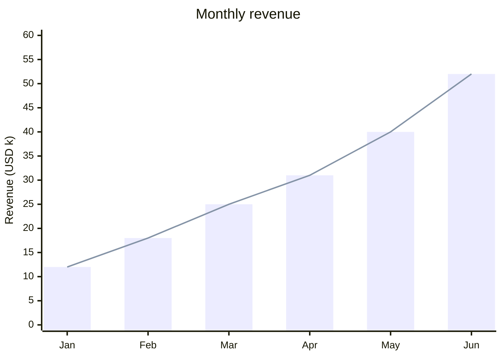
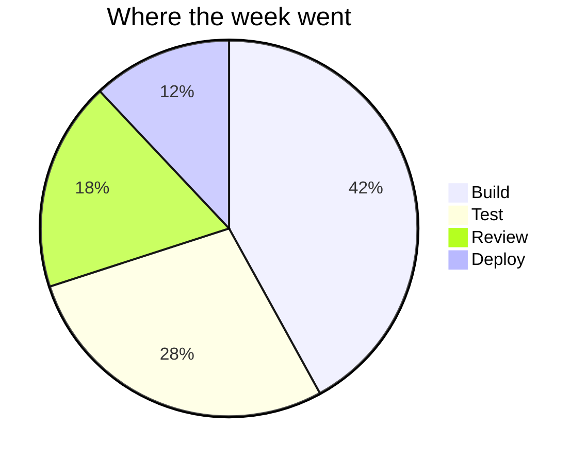

## When to Use

The person asks for a graph, chart or plot, or the answer is a set of numbers whose shape matters: a trend over time, a comparison between a few things, or how a whole splits into parts.

## Procedure

1. Get the numbers right first. If they come from a file or a calculation, compute them (the `analyze-data` skill) and chart the results you printed, never estimates.
2. Pick the chart by the question:
   - change over time, or comparing up to about 12 items: `xychart-beta` with `bar`, `line`, or both
   - parts of one whole, 6 slices or fewer: `pie`
   - placing items on two judgements (effort and impact): `quadrantChart`
   - anything else, or more than one dimension: a table is better than a chart
3. Write it in a fenced block whose language is `mermaid`; Pantheon draws it in the chat in the person's colours. Give it a `title`, name the y-axis with its unit, and keep x labels short.
4. When the person needs a file (a report, a slide, an email), and the `python` tool is available, draw it with matplotlib, save a PNG, and say where it is.
5. Say in one sentence what the chart shows before it, and give the exact figures in a small table when people will quote them.

## Examples

## Pitfalls

- A y-axis that does not start at zero for bars, which exaggerates differences.
- A pie with many thin slices; use bars instead.
- Numbers in the chart that differ from the numbers in the text.
- Quotes or commas inside x-axis labels; keep them single plain words or wrap each in double quotes.

## Verification

- Every value in the chart matches the source or the computation.
- The chart has a title and the unit is stated.
