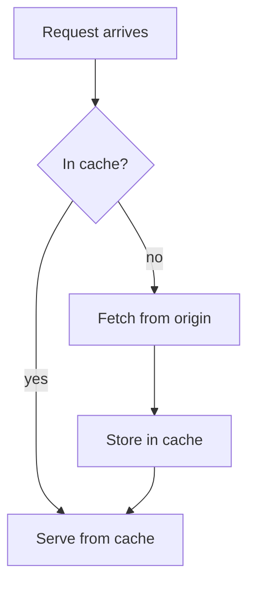

## When to Use

The person asks for a flow chart, diagram, process map, decision tree, architecture sketch, sequence of calls, state machine, data model, mind map, timeline or project schedule. Also use it unasked when steps branch or loop and a picture is clearer than a list.

## Procedure

1. Pick the one diagram type that fits what is being shown:
   - steps and decisions: `flowchart TD` (top to bottom) or `flowchart LR`
   - who talks to whom, in order: `sequenceDiagram`
   - states and what moves between them: `stateDiagram-v2`
   - tables and how they relate: `erDiagram`
   - ideas around one topic: `mindmap`
   - dated events: `timeline`
   - tasks over days or weeks: `gantt`
2. Write it in a fenced block whose language is `mermaid`. Pantheon draws it in the chat; nothing else is needed and no file is written.
3. Keep it readable on a phone: 12 nodes or fewer, labels of a few words, and `TD` rather than `LR` when there are more than five steps in a row. Split a big picture into two diagrams.
4. Quote any label that holds punctuation: `A["Check (optional)"]`. Use `-->|yes|` for words on an arrow. Use plain ids (`A`, `B`, `checkCache`), never spaces or reserved words such as `end` as an id.
5. Put one or two sentences before the diagram that say what it shows, and after it anything the picture cannot say.

## Example



## Pitfalls

- Drawing a diagram for a straight list of steps with no branches: a numbered list is clearer.
- Labels that are whole sentences; the boxes become unreadable.
- Unquoted labels with brackets, colons or quotes, which stop the diagram from drawing.
- Styling with colours: Pantheon themes every diagram to the person's palette, light or dark.

## Verification

- The block starts with ```` ```mermaid ```` and its first line names a diagram type.
- Every arrow points at an id that exists, and every decision has a labelled way out.
